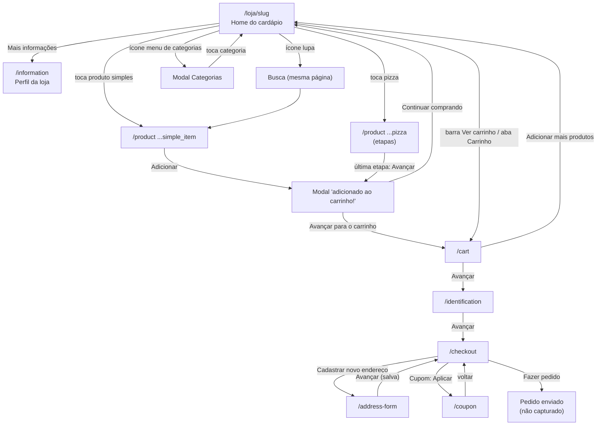

# Especificação — Fluxo do consumidor no cardápio digital (mobile)

## Como usar este documento

- **O que é:** especificação do fluxo de compra do cliente final num cardápio digital de delivery (referência: loja "Pizzaria Independencia", que usa a Anota.ai, em `https://pedido.anota.ai/loja/pizzariaindependncia`). Serve para você, agente implementador, recriar essas telas e regras na codebase.
- **Onde estão os prints:** todos os PNGs estão **na mesma pasta** deste arquivo. Cada tela aponta para o print com caminho relativo, por exemplo `./14-carrinho.png`.
- **Regra de trabalho:** antes de implementar cada tela, **abra os prints citados** na seção e confira layout, textos e estados. Os textos entre aspas são exatamente os que aparecem na tela — use iguais (ou ajuste para a marca do usuário).
- **Viewport:** todos os prints são mobile, 414 × 697 px. Implemente mobile-first.
- **Incerteza:** o que não foi possível confirmar está marcado como **(não confirmado no print)**. Não trate isso como requisito fechado.
- **Nenhum pedido real foi enviado.** O fluxo para na tela final com o botão "Fazer pedido".
- **Prints duplicados:** alguns arquivos têm conteúdo idêntico a outro (falha de captura). Eles estão sinalizados com ⚠️. Use o print indicado como fonte.

## Visão geral

### Mapa de rotas e navegação

Rotas observadas na loja de referência (adapte os nomes à sua codebase):

| Rota | Tela |
|---|---|
| `/loja/<slug>` | Home do cardápio |
| `/information` | Perfil da loja |
| `/product/<id>/<slug>?categoryType=simple_item` | Produto simples |
| `/product/<id>/<slug>?categoryType=pizza` | Produto com etapas (pizza) |
| `/cart` | Carrinho |
| `/identification` | Identificação do cliente |
| `/checkout` | Finalizar pedido |
| `/address-form` | Cadastro de endereço |
| `/coupon?from=/checkout&manual_code_only=1` | Aplicar cupom |

### Entidades de dados (campos observados nos prints)

| Entidade | Campos observados | Prints |
|---|---|---|
| **Loja** | nome, logo, slug, status/horário ("Aberto até 23h59"), pedido mínimo (ex.: R$ 24,00), formas de pagamento online e na entrega, bandeiras de cartão aceitas na entrega, endereço completo (rua, número, bairro, cidade, UF, CEP), mapa, tempo estimado de entrega ("35 - 55 min") | `./02-info-loja.png`, `./03-info-loja-pagamentos-endereco.png` |
| **Categoria** | nome, ordem, ícone de promoção (selo %) opcional | `./09-categorias-modal.png` |
| **Produto** | nome, descrição, foto, preço atual, preço original riscado, % de desconto (selo verde), tipo (`simple_item` ou `pizza`) | `./04-busca-resultados.png`, `./05-produto-detalhe-simples.png`, `./11-produto-com-opcoes-obrigatorias.png` |
| **GrupoDeAdicionais** (etapa) | título (ex.: "Sabor Pizza Broto 4 Fatias", "Borda Pizza Broto 4 Fatias"), subtítulo de regra ("Escolha 1 sabor", "Escolha até 1 borda"), obrigatório (selo "Obrigatório"), mínimo/máximo, contador selecionados/máximo ("0 / 1") | `./11-produto-com-opcoes-obrigatorias.png`, `./12-produto-etapa-borda-opcional.png` |
| **Adicional** (opção) | nome, descrição, preço, imagem (placeholder quando não tem), limite por opção ("Máx 1") | `./11-...`, `./12-...` |
| **Carrinho** | itens, subtotal ("Total sem entrega"), total | `./14-carrinho.png` |
| **ItemDoCarrinho** | produto, quantidade, observação ("Obs: Sem"), opções escolhidas agrupadas por grupo (ex.: "Sabor ... 1/1 Marguerita", "Borda ... 1x Borda Catupiry"), preço total da linha, preço original riscado | `./14-carrinho.png`, `./15-carrinho-qtd-alterada.png` |
| **Cliente** | WhatsApp (telefone com máscara), nome e sobrenome | `./16-...` a `./19-...` |
| **Endereço** | bairro, cidade, UF, rua, número ou "Sem número", complemento, ponto de referência, CEP (usado na busca) | `./22-...`, `./24-...` |
| **Cupom** | código; resultado da validação (válido/inválido) | `./32-...` a `./34-...` |
| **FormaDePagamento** | grupo ("Pagar agora" online / "Pagar na entrega"), nome, descrição, ícone; para Dinheiro: troco para (opcional) | `./26-...`, `./29-...`, `./30-...` |
| **Pedido** | cliente, endereço, previsão de entrega, forma de pagamento (+ troco), cupom, observações, subtotal, taxa de entrega, total | `./31-...`, `./35-...` |

### Elementos globais

- **Barra inferior fixa** em todas as telas do cardápio: "Início" (casa), "Pedidos" (sacola), "Carrinho" (carrinho). Aba ativa em verde. Ver `./04-busca-resultados.png`.
- **Cabeçalho do checkout:** seta voltar + título + selo verde "Ambiente seguro" à direita. Ver `./16-identificacao-vazia.png`.
- **Botão principal fixo no rodapé:** largura total, verde quando habilitado, cinza quando desabilitado; à esquerda o texto da ação e à direita o valor em R$ quando aplicável. Ver `./05-...`, `./11-...`.
- **Loading em modal:** caixa branca central com spinner e texto ("Buscando dados do cliente...", "Validando cupom...") sobre fundo escurecido. Ver `./17-...`, `./33-...`.
- **Moeda:** formato brasileiro "R$ 29,99".

---

## 1. Navegação no cardápio (home, perfil da loja, busca, categorias)

**Objetivo:** o cliente abre o link da loja, vê informações da loja, navega pelas categorias, busca produtos e abre um produto.

**Prints:**
- `./01-home.png` — ⚠️ nome errado: mostra o **final do Perfil da loja** (idêntico a `./03-...`). A home em si **não foi capturada**.
- `./02-info-loja.png` — Perfil da loja, topo: nome, pedido mínimo, horário, formas de pagamento online.
- `./03-info-loja-pagamentos-endereco.png` — Perfil da loja, final: pagamento na entrega, bandeiras e endereço.
- `./04-busca-resultados.png` — Busca com resultados para "calabresa".
- `./09-categorias-modal.png` — Modal "Categorias" aberto sobre a home (mostra também o cabeçalho e as abas da home).
- `./10-categoria-pizzas-tradicionais.png` — ⚠️ idêntico a `./09-...`; a seção de categoria **não foi capturada**.

### Tela: Home do cardápio (`/loja/<slug>`)
Observado parcialmente em `./04-...` e `./09-...`:
- Cabeçalho: logo redondo da loja + nome (truncado com "..."), ícones à direita: **lupa** (busca), **lua** (tema escuro), **compartilhar**.
- Abaixo: ícone de menu (abre modal Categorias) + **abas horizontais de categorias** roláveis; aba ativa com sublinhado verde (ex.: "Promoções do Dia! intens com até 47% OFF").
- Conteúdo: lista de produtos por categoria. Carrossel "Destaques" com botão "+" **(não confirmado no print)**. Texto "Aberto até 23h59", pedido mínimo e link "Mais informações" **(não confirmado no print da home; confirmado no perfil e no print `../anota-lojista/50-cardapio-publico-cliente.png` do outro pacote)**.
- **Card de produto (lista):** nome (negrito), descrição (até ~2 linhas, cortada com "..."), preço atual em verde, preço original riscado + selo verde com % de desconto, foto quadrada à direita com cantos arredondados. Ver `./04-...`.

### Tela: Perfil da loja (`/information`)
- Cabeçalho "Perfil da loja" com seta voltar.
- Logo + nome da loja.
- "Pedido mín. R$ 24,00".
- Seção cinza "Horário de atendimento" → "Aberto até 23h59".
- Seção "Formas de pagamento": lista com ícone + nome + subtítulo "Pagamento online": Pix, Pagar com iFood, Google Pay, Nubank, Cartão de crédito (Online).
- Depois: "Dinheiro — Pagamento na entrega"; "Cartões — Pagamento na entrega" com **chips** das bandeiras (American Express crédito, Elo Crédito, Mastercard Crédito, Nugo crédito, Ticket refeição, Sodexo refeição, Alelo refeição, Elo Débito, Visa Débito, VR refeição, Visa Crédito, Banricompras crédito, Hipercard crédito, Mastercard Débito, Goodcard crédito).
- Seção "Endereço": endereço completo em uma linha com seta ">" (clicável, abre mapa — comportamento do MD anterior) e um mapa logo abaixo.

### Tela: Busca
- Ao tocar na lupa, aparece campo de busca com ícone de lupa, borda verde quando focado e "X" para limpar.
- Título "Resultados da pesquisa" e lista de cards de produto (mesmo card da home).
- Filtra ao pressionar Enter (MD anterior). Busca em tempo real **(não confirmado no print)**.

### Modal: Categorias
- Título "Categorias" + "X" para fechar.
- Lista de categorias, uma por linha, separadas por divisória. A categoria atual fica com fundo verde claro.
- Categorias com promoção mostram um ícone de % ao lado do nome.
- Tocar numa categoria fecha o modal e rola a home até a seção (MD anterior).

### Comportamento esperado
1. Cliente abre `/loja/<slug>` e vê cabeçalho, abas de categorias e produtos.
2. "Mais informações" abre `/information`.
3. Lupa abre o campo de busca; ao confirmar, mostra "Resultados da pesquisa".
4. Ícone de menu abre o modal "Categorias"; tocar numa categoria rola até ela e ativa a aba.
5. Tocar num card de produto abre a tela de produto (simples ou com etapas, conforme o tipo).

### Critérios de aceite
- [ ] Home mostra cabeçalho com logo, nome e ícones de busca, tema e compartilhar.
- [ ] Abas de categorias roláveis, aba ativa sublinhada, sincronizadas com a rolagem.
- [ ] Card de produto exibe preço atual, preço riscado e selo de % quando houver desconto.
- [ ] Perfil da loja lista pedido mínimo, horário, pagamentos online, pagamentos na entrega com chips de bandeiras e endereço com mapa.
- [ ] Busca filtra produtos e exibe "Resultados da pesquisa"; "X" limpa o campo.
- [ ] Modal "Categorias" destaca a categoria atual e navega até a seção escolhida.
- [ ] Barra inferior Início / Pedidos / Carrinho sempre visível.

### Lacunas
- Home completa (topo com status, carrossel de destaques, seção de categoria com "A partir de R$...") não tem print válido.
- Tela "Pedidos" da barra inferior e tema escuro não capturados.
- Estado "loja fechada" não capturado.

---

## 2. Produto simples

**Objetivo:** o cliente vê um produto sem opções, escolhe quantidade, escreve observação e adiciona ao carrinho.

**Prints:**
- `./05-produto-detalhe-simples.png` — Produto "Pizza Calabresa", quantidade 1.
- `./06-produto-qtd-obs.png` — Quantidade 2 e observação "Sem"; total do botão atualizado.
- `./07-adicionado-ao-carrinho-modal.png` — Modal de confirmação depois de adicionar.
- `./08-home-com-barra-ver-carrinho.png` — ⚠️ idêntico a `./07-...`; a barra "Ver carrinho" **não foi capturada**.

### Tela: Detalhe do produto simples
- Foto grande no topo (largura total), botão redondo **voltar** (esquerda) e **compartilhar** (direita) sobre a foto, e um botão redondo com seta para baixo no centro (recolher a foto — **(não confirmado no print)**).
- Card branco: nome ("Pizza Calabresa"), preço atual verde ("R$ 29,99"), preço original riscado ("R$ 48,90") + selo "39%", descrição.
- Card "Observações": textarea, placeholder "Ex.: Tirar cebola, ovo, etc.". Opcional. Limite de caracteres **(não confirmado no print)**.
- Rodapé fixo: contador **"−" / quantidade / "+"** e botão verde **"Adicionar"** com o total à direita ("R$ 29,99").
  - O "−" fica cinza (desabilitado) com quantidade 1 (`./05-...`) e ativo com quantidade 2 (`./06-...`).
  - O total do botão = preço unitário × quantidade, atualizado na hora (2 × 29,99 = "R$ 59,98").

### Modal: "adicionado ao carrinho!"
- Ilustração (sacola com check), texto "**<Nome do produto> adicionado ao carrinho!**".
- Linha "Quantidade" com contador "−" / número / "+" (permite ajustar ali mesmo).
- Botão verde "**Avançar para o carrinho**" → `/cart`.
- Link verde "**Continuar comprando**" → volta para a home.

### Comportamento esperado
1. Abrir produto com quantidade 1 e observação vazia.
2. "+"/"−" alteram a quantidade (mínimo 1) e o total do botão.
3. "Adicionar" coloca o item (com quantidade e observação) no carrinho e abre o modal.
4. Na home, aparece uma barra fixa "R$ total / N item · Total sem entrega · Ver carrinho" e um badge no ícone do carrinho (MD anterior, **sem print válido**).

### Critérios de aceite
- [ ] Preço com desconto mostra preço atual, preço riscado e selo de %.
- [ ] Quantidade mínima 1; "−" desabilitado em 1.
- [ ] Botão "Adicionar" mostra o total calculado em tempo real.
- [ ] Observação é salva no item do carrinho e aparece como "Obs: <texto>".
- [ ] Modal de confirmação permite mudar quantidade, ir ao carrinho ou continuar comprando.

### Lacunas
- Barra "Ver carrinho" e badge do carrinho sem print.
- Compartilhar produto não capturado.

---

## 3. Produto com etapas (pizza: sabor, borda, massa)

**Objetivo:** produto que exige escolhas em etapas (grupos de adicionais), com grupos obrigatórios e opcionais, e preço que soma as escolhas.

**Prints:**
- `./11-produto-com-opcoes-obrigatorias.png` — Etapa 1 "Sabor", obrigatória, botão desabilitado.
- `./12-produto-etapa-borda-opcional.png` — Etapa "Borda", opcional, botão "Avançar".
- `./13-produto-etapa-massa-adicionais.png` — ⚠️ idêntico a `./12-...`; a etapa "Massa" **não foi capturada**.

### Tela: Produto em etapas
- Topo: foto + nome ("Pizza Broto 4 Fatias") + descrição ("Pizza com 1 sabor e 8 fatias").
- Campo de busca dentro do produto: "Pesquise pelo nome" (filtra opções do grupo).
- **Cabeçalho do grupo:** título ("Sabor Pizza Broto 4 Fatias"), subtítulo ("Escolha 1 sabor"), selo verde "**Obrigatório**" e contador "**0 / 1**".
- **Opção:** imagem (placeholder quando não há foto), nome, descrição, preço ("R$ 43,90"), **radio** à direita (máx. 1). Em grupos com limite por opção aparece "Máx 1".
- Ao rolar, o cabeçalho vira barra fixa com seta voltar, nome do produto, lupa e compartilhar (`./12-...`).
- **Botão do rodapé:**
  - Grupo obrigatório sem escolha: cinza/desabilitado com texto "**Escolha sabor**" e "R$ 0,00" (`./11-...`).
  - Depois da escolha: avança sozinho para o próximo grupo (MD anterior).
  - Grupo opcional: botão verde "**Avançar**" com o total acumulado ("R$ 43,90") (`./12-...`).
  - Na última etapa, "Avançar" adiciona o item ao carrinho e abre o modal "adicionado ao carrinho!" (MD anterior).
- Grupo "Borda" (`./12-...`): "Borda Pizza Broto 4 Fatias", "Escolha até 1 borda", opções com preço adicional (Borda Catupiry R$ 9,90; Borda Cheddar R$ 9,90; Borda Cheddar R$ 12,90; Borda Presunto e Queijo R$ 13,90; Borda Calabresa com Catupiry R$ 13,90; Borda Frango com Catupiry R$ 13,90).

### Regras de preço
- Total = preço do sabor escolhido + soma dos adicionais escolhidos, × quantidade.
- Exemplo confirmado no carrinho (`./14-carrinho.png`): Marguerita (R$ 43,90) + Borda Catupiry (R$ 9,90) = **R$ 53,80**.

### Comportamento esperado
1. Abrir o produto na etapa 1 (obrigatória). Botão desabilitado com "Escolha <grupo>".
2. Ao marcar uma opção num grupo de máximo 1, o contador vira "1 / 1" e a tela avança para o próximo grupo.
3. Em grupos opcionais, o cliente pode pular com "Avançar".
4. Na última etapa, "Avançar" adiciona ao carrinho com todas as opções.

### Critérios de aceite
- [ ] Grupos exibem selo "Obrigatório" e contador selecionados/máximo.
- [ ] Botão bloqueado enquanto um grupo obrigatório não atingir o mínimo.
- [ ] Não permite selecionar mais que o máximo do grupo (radio quando máx. 1).
- [ ] Total do botão soma o preço das opções em tempo real.
- [ ] Busca "Pesquise pelo nome" filtra opções.
- [ ] Item no carrinho mostra as opções agrupadas por grupo.

### Lacunas
- Etapa "Massa" e os adicionais dela não capturados.
- Pizza meio a meio (2 sabores, regra de preço) não capturada.
- Grupos com máximo > 1 (checkbox/contador) não capturados.

---

## 4. Carrinho

**Objetivo:** revisar itens, alterar quantidades, remover, editar e seguir para a identificação.

**Prints:**
- `./14-carrinho.png` — Carrinho com 2 itens (um simples, um com opções).
- `./15-carrinho-qtd-alterada.png` — Quantidade do 2º item alterada para 2, totais recalculados.

### Tela: Carrinho (`/cart`)
- Cabeçalho "Carrinho" com seta voltar.
- **Card de item:** foto pequena, título "**<qtd> x <nome>**", observação ("Obs: Sem"), opções agrupadas (nome do grupo + linhas como "1/1 Marguerita" e "**1x** Borda Catupiry"), preço da linha em negrito, preço original riscado quando houver desconto, ícone de **lápis** (editar) no canto superior direito.
- Contador por item: "−" / quantidade / "+". Com quantidade 1, o "−" vira **lixeira** (remover).
- Link verde "**Adicionar mais produtos**" → home.
- Rodapé: botão verde "**Avançar**" com o total ("R$ 113,78").

### Comportamento esperado
1. Alterar quantidade recalcula o preço da linha e o total na hora (`./15-...`: 2 × 53,80 = R$ 107,60; total R$ 167,58).
2. Lixeira (quantidade 1) remove o item.
3. Lápis abre o produto para edição.
4. "Avançar" vai para `/identification` (ou direto ao checkout se o cliente já estiver identificado — **(não confirmado no print)**).

### Critérios de aceite
- [ ] Linha do item mostra qtd, nome, observação, opções agrupadas e preço da linha.
- [ ] "−" vira lixeira quando a quantidade é 1.
- [ ] Totais recalculam sem recarregar a página.
- [ ] Botão "Avançar" mostra o total do carrinho (sem entrega).
- [ ] Pedido mínimo da loja é respeitado **(não confirmado no print — regra esperada, sem mensagem capturada)**.

### Lacunas
- Remoção, edição pelo lápis e carrinho vazio não capturados.
- Mensagem de pedido mínimo não atingido não capturada.

---

## 5. Identificação do cliente

**Objetivo:** identificar o cliente por WhatsApp e nome, sem senha e sem código de verificação.

**Prints:**
- `./16-identificacao-vazia.png` — Formulário vazio, botão desabilitado.
- `./17-identificacao-buscando-cliente.png` — Modal "Buscando dados do cliente..." após completar o telefone.
- `./18-identificacao-preenchida-fake.png` — Formulário preenchido com dados fictícios, botão habilitado.

### Tela: Identifique-se (`/identification`)
- Cabeçalho "Identifique-se" + selo "Ambiente seguro".
- Campo 1 — label "**Seu número de WhatsApp é:**"; tipo telefone; máscara `(__) _____-____` (exibido preenchido como "(11) 0 0000-0000"); obrigatório; vem focado.
- Campo 2 — label "**Seu nome e sobrenome:**"; texto; placeholder "Nome e sobrenome"; obrigatório. Validação de exigir sobrenome **(não confirmado no print)**.
- Botão "**Avançar**": cinza/desabilitado com campos vazios; verde quando ambos preenchidos.
- Texto abaixo: "Para realizar seu pedido vamos precisar de suas informações, este é um ambiente protegido."

### Comportamento esperado
1. Ao completar o telefone, mostrar modal de loading "**Buscando dados do cliente...**" e consultar se o cliente já existe pela loja.
2. Se existir, preencher o nome **(não confirmado no print)**; se não, focar o campo nome.
3. "Avançar" salva o cliente (loading "Salvando informações do cliente..." — MD anterior, sem print) e vai para `/checkout`.
4. Não há envio de código por SMS/WhatsApp nesse fluxo.

### Critérios de aceite
- [ ] Máscara de telefone brasileiro com DDD.
- [ ] "Avançar" só habilita com telefone completo e nome preenchido.
- [ ] Lookup do cliente pelo telefone com modal de loading.
- [ ] Cliente salvo e redirecionado para o checkout.

### Lacunas
- Mensagens de erro de telefone inválido não capturadas.
- Cliente existente (auto-preenchimento) não capturado.

---

## 6. Checkout — confirmação de dados e escolha de onde receber

**Objetivo:** confirmar os dados do cliente e escolher o endereço de entrega.

**Prints:**
- `./19-checkout-confirme-seus-dados-modal.png` — Modal "Confirme seus dados" ao entrar no checkout.
- `./20-checkout-escolha-onde-receber.png` — Checkout sem endereço: "Escolha onde receber".
- `./21-endereco-busca-vazia.png` — ⚠️ idêntico a `./20-...`; a tela de busca vazia **não foi capturada**.

### Modal: "Confirme seus dados" (bottom sheet)
- Linha com ícone de pessoa: "Eu sou" + nome.
- Linha com ícone de celular: "Meu telefone é" + telefone.
- Botão verde "**Confirmar**"; link verde "**Editar informações**" (volta para identificação).

### Tela: Finalizar pedido (`/checkout`) — estado sem endereço
- Cabeçalho "Finalizar pedido" + "Ambiente seguro".
- Card "**Será entregue para**": ícone pessoa, nome, telefone, link "**Trocar**".
- Card com cabeçalho verde "**Escolha onde receber**": opção "Cadastrar novo endereço" com ícone de casa, tempo "35 - 55 min" e radio.
- Resumo: "Subtotal R$ 167,58" e "**Total R$ 167,58**".
- Botão do rodapé desabilitado: "**Escolha como receber o pedido**".

### Critérios de aceite
- [ ] Modal de confirmação aparece ao entrar no checkout com nome e telefone.
- [ ] "Editar informações" volta para a identificação.
- [ ] Sem endereço, o botão principal fica desabilitado com "Escolha como receber o pedido".
- [ ] "Cadastrar novo endereço" abre `/address-form`.

### Lacunas
- Opção de retirada no local (a loja só entrega) não capturada.
- Lista de endereços já salvos e "Trocar" cliente não capturados.

---

## 7. Cadastro de endereço

**Objetivo:** buscar o endereço por texto ou CEP e completar número/complemento.

**Prints:**
- `./22-endereco-resultado-cep.png` — Busca por CEP com resultado.
- `./23-endereco-formulario.png` — ⚠️ idêntico a `./22-...`; o formulário vazio **não foi capturado**.
- `./24-endereco-formulario-preenchido.png` — Formulário com número preenchido, botão habilitado.
- `./25-endereco-salvando.png` — Tela cheia "Salvando seu endereço...".

### Tela: Novo endereço — busca (`/address-form`)
- Cabeçalho "Novo endereço" + "Ambiente seguro".
- Título "**Digite o seu endereço**".
- Campo de busca com lupa e "X"; aceita endereço ou CEP (ex.: "05887000"). Placeholder **(não confirmado no print)**.
- Resultados em lista: rua em negrito ("Av. Andorinha-dos-Beirais") + "bairro, cidade, UF" e seta ">".
- Faixa vermelha clara: ícone de pin + "**Encontre mais fácil, ative o localizador**" + ">".
- Botão "**Usar minha localização**" (geolocalização do navegador).

### Tela: Novo endereço — completar
- Título "**Finalize o cadastro do endereço**".
- Faixa com bairro ("Jardim Dom José") e "São Paulo - SP" + botão "**Trocar**" (volta para a busca).
- Campos:
  | Campo | Tipo | Obrigatório | Placeholder |
  |---|---|---|---|
  | Rua* | texto (pré-preenchido pela busca) | sim | — |
  | Número* | texto/numérico | sim, salvo se "Sem número" | — |
  | Sem número | checkbox | — | — |
  | Complemento | texto | não | "Casa, Apto, Sala X..." |
  | Ponto de referência | texto | não | "Em frente ao..." |
- Botão "**Avançar**": desabilitado sem número (MD anterior); verde com número preenchido (`./24-...`).

### Comportamento esperado
1. Digitar endereço/CEP mostra sugestões (autocomplete).
2. Tocar numa sugestão abre o formulário com rua, bairro, cidade e UF preenchidos.
3. Preencher Número (ou marcar "Sem número") habilita "Avançar".
4. "Avançar" mostra tela cheia com spinner "**Salvando seu endereço...**", salva e volta ao checkout com o endereço selecionado e a taxa de entrega calculada.

### Critérios de aceite
- [ ] Busca por CEP e por texto com lista de sugestões.
- [ ] "Usar minha localização" pede permissão de geolocalização.
- [ ] Número obrigatório, exceto com "Sem número" marcado.
- [ ] Loading de tela cheia ao salvar.
- [ ] Após salvar, checkout mostra endereço e taxa de entrega.

### Lacunas
- Endereço fora da área de entrega (mensagem de erro) não capturado.
- Fluxo do localizador não capturado.

---

## 8. Pagamento

**Objetivo:** escolher como pagar: online ("Pagar agora") ou na entrega (Dinheiro com troco, ou Cartão).

**Prints:**
- `./26-checkout-pagamento-opcoes.png` — Lista "Pagar agora" (Pix, Nubank, Cartão de crédito, Google Pay, iFood) e acordeão "Pagar na entrega" fechado.
- `./27-checkout-topo-entrega-endereco.png` — ⚠️ idêntico a `./26-...`; o topo com endereço **não foi capturado**.
- `./28-checkout-totais-taxa-entrega.png` — Totais com taxa de entrega e texto de Política de Privacidade.
- `./29-checkout-pagar-na-entrega-expandido.png` — Acordeão "Pagar na entrega" aberto: Dinheiro e Cartão.
- `./30-pagamento-dinheiro-troco-modal.png` — Modal "Precisa de troco?".

### Tela: Escolha como pagar (dentro do checkout)
- Card com borda verde. Grupo "**Pagar agora**" (título cortado no print) com subtítulo "Pague com agilidade e segurança" e selo verde "**Mais rápido**".
- Opções (ícone + nome + descrição + controle à direita):
  - Pix — "Pague agora" — radio
  - Nubank — "Pagamento pelo app Nubank" — radio
  - Cartão de crédito — "Aceitamos as principais bandeiras" — **seta ">"** (abre outra tela; não capturada)
  - Google Pay — "Pague agora" — radio
  - Pagar com iFood — "Pagamento pelo app iFood" — radio
- Acordeão cinza "**Pagar na entrega**" com seta; aberto mostra "Dinheiro" e "Cartão" (radios).
- Resumo: "Subtotal R$ 167,58", "Taxa de entrega R$ 3,00", "**Total R$ 170,58**".
- Texto: "Ao fazer o pedido, você concorda com a **Política de Privacidade** da Anota AI." (link).
- Botão desabilitado: "**Selecione a forma de pagamento**".

### Modal: "Precisa de troco?" (ao escolher Dinheiro)
- Título "Precisa de troco?" e "Seu pedido fechou em **R$ 170,58**".
- Campo "**Troco para** (opcional)", tipo moeda, placeholder "R$ 50,00".
- Botão contornado verde "**Não preciso de troco**".
- Botão "**Confirmar**" — cinza/desabilitado enquanto o campo está vazio.
- Bloco de incentivo: ícone Pix + "Pague online e agilize sua entrega" + botão "**Pagar com Pix**".
- Validação "troco menor que o total" **(não confirmado no print)**.

### Comportamento esperado
1. Sem forma escolhida, botão principal desabilitado.
2. Escolher Dinheiro abre o modal de troco. "Não preciso de troco" fecha e grava "Sem troco"; "Confirmar" grava o valor.
3. Depois de escolher, o card de pagamento mostra a forma escolhida (ver seção 10).

### Critérios de aceite
- [ ] Formas agrupadas em "Pagar agora" (online) e "Pagar na entrega" (acordeão).
- [ ] Só uma forma selecionada por vez.
- [ ] Modal de troco com opção "Não preciso de troco" e confirmação de valor.
- [ ] Taxa de entrega somada ao total depois do endereço.
- [ ] Formas exibidas vêm da configuração da loja.

### Lacunas
- Telas de Pix (QR/copia e cola), cartão online, Google Pay, Nubank e iFood não capturadas.
- Escolha de bandeira no "Cartão" na entrega não capturada.

---

## 9. Cupom

**Objetivo:** aplicar um código de cupom no checkout.

**Prints:**
- `./32-cupom-tela.png` — Tela do cupom vazia.
- `./33-cupom-erro-toast-validando.png` — Loading "Validando cupom..." e toast de erro.
- `./34-cupom-erro-inline.png` — Erro inline no campo.

### Tela: Cupom (`/coupon?from=/checkout&manual_code_only=1`)
- Cabeçalho "Cupom" com seta voltar.
- Campo texto, placeholder "**Digite seu cupom**" (exibido em maiúsculas: "TESTE").
- Botão contornado verde "**Aplicar**".
- Ao aplicar: modal "**Validando cupom...**" com spinner.
- Erro: toast escuro no topo com ícone e "**Código de cupom inexistente ou expirado.**" + "X"; e erro inline em vermelho abaixo do campo, com borda vermelha: "**Não foi possível inserir esse cupom.**".

### Comportamento esperado
1. No checkout, o card "Você tem um **Cupom?** Digite o código ⓘ" + "**Aplicar**" abre `/coupon`.
2. "Aplicar" valida no servidor (loja, validade, uso, pedido mínimo).
3. Inválido: toast + erro inline; o cliente continua na tela.
4. Válido: volta ao checkout com desconto no resumo **(não confirmado no print)**.

### Critérios de aceite
- [ ] Botão "Aplicar" dispara validação com loading.
- [ ] Código inválido mostra exatamente os dois textos de erro acima.
- [ ] Código convertido para maiúsculas.
- [ ] Cupom válido aplica desconto e mostra no resumo **(não confirmado no print)**.

### Lacunas
- Cupom válido, remoção do cupom e linha de desconto no resumo não capturados.
- Lista de cupons disponíveis ("Carteira de promoções") não capturada (o parâmetro `manual_code_only=1` sugere que ela existe).

---

## 10. Finalização do pedido

**Objetivo:** revisar tudo e enviar o pedido.

**Prints:**
- `./31-checkout-resumo-final-fazer-pedido.png` — Resumo final com pagamento escolhido e botão "Fazer pedido".
- `./35-checkout-observacoes-expandido.png` — "Observações" aberto.

### Tela: Finalizar pedido — pronto para enviar
De cima para baixo:
- Previsão: ícone de relógio + "**Previsão: Entre 35 - 55 minutos**".
- Card "**Pagamento**": forma escolhida ("Dinheiro") + detalhe ("Sem troco") + "**Trocar**".
- Card de cupom: ícone rosa, "Você tem um **Cupom?**", "Digite o código ⓘ", "**Aplicar**".
- Acordeão "**Observações**": aberto mostra textarea com placeholder "Ex.: Apertar campainha, não buzinar, etc.".
- Resumo: Subtotal, Taxa de entrega, **Total**.
- Texto da Política de Privacidade.
- Botão verde "**Fazer pedido**".

### Comportamento esperado
1. Com endereço e pagamento definidos, "Fazer pedido" fica verde.
2. Ao tocar, criar o Pedido com: itens, cliente, endereço, forma de pagamento (+ troco), cupom, observações, subtotal, taxa e total.
3. Pedido entra no painel do lojista na coluna "Em análise" (ver `../anota-lojista/PAINEL.md`, seção Pedidos).
4. Tela de sucesso/acompanhamento **(não confirmado no print — não foi enviado pedido)**.

### Critérios de aceite
- [ ] Botão "Fazer pedido" só habilita com endereço e pagamento escolhidos.
- [ ] Previsão de entrega vem da configuração da loja.
- [ ] Observações do pedido são opcionais e enviadas com o pedido.
- [ ] Resumo mostra subtotal, taxa de entrega e total corretos.
- [ ] Pedido criado aparece no painel do lojista.

### Lacunas
- Tela pós-pedido (confirmação, acompanhamento de status, aba "Pedidos") não capturada.
- Topo do checkout com endereço selecionado e "Trocar" (print 27 duplicado).

---

## Fora do escopo / não capturado

- **Home completa** do cardápio (topo, destaques, seção de categoria): `./01-home.png` e `./10-...` não mostram isso.
- Barra fixa "Ver carrinho" na home (`./08-...` duplicado).
- Etapa "Massa" do produto com etapas (`./13-...` duplicado) e pizza meio a meio.
- Formulário de endereço vazio (`./23-...` duplicado), busca de endereço vazia (`./21-...` duplicado), topo do checkout com endereço (`./27-...` duplicado).
- Retirada no local (a loja de referência só entrega).
- Telas de pagamento online: Pix, cartão de crédito, Google Pay, Nubank, iFood.
- Trocar cliente/endereço, edição de item pelo lápis, remoção de item, carrinho vazio.
- Cupom válido e desconto aplicado.
- Envio do pedido, tela de sucesso, acompanhamento e histórico de pedidos.
- Tema escuro, compartilhamento, loja fechada, erros de rede.
