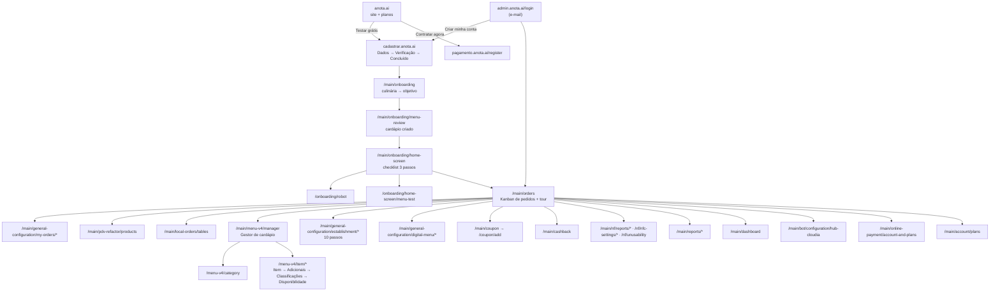
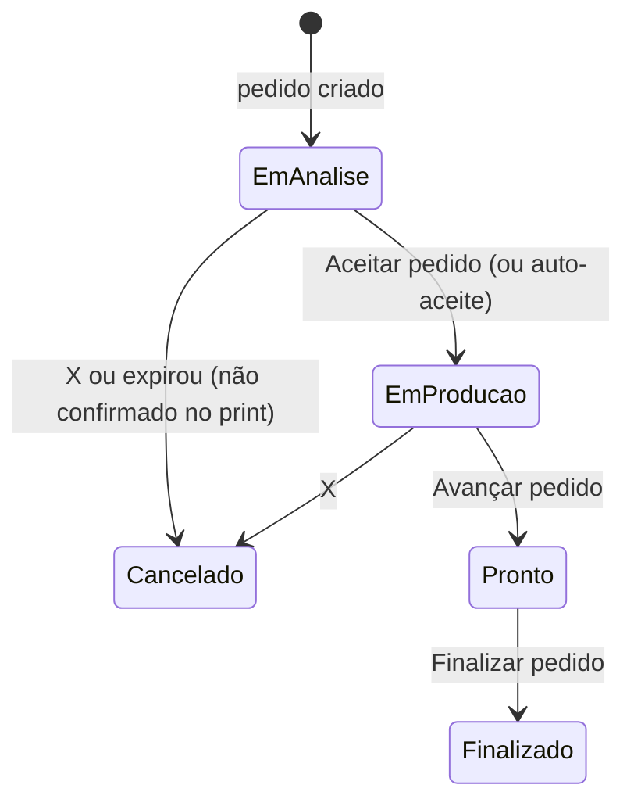

# Especificação — Painel do lojista (admin de delivery)

## Como usar este documento

- **O que é:** especificação do painel do lojista de um SaaS de delivery/cardápio digital (referência: Anota.ai, `https://admin.anota.ai`, loja de teste "Ceremony"). Serve para você, agente implementador, recriar as telas, regras e fluxos na codebase.
- **Onde estão os prints:** todos os PNGs estão **na mesma pasta** deste arquivo. Cada tela aponta para o print com caminho relativo, por exemplo `./52-cardapio-gestor.png`.
- **Regra de trabalho:** antes de implementar cada tela, **abra os prints citados** na seção. Textos entre aspas são exatamente os da tela.
- **Viewport:** desktop, 1920 px de largura (prints exibidos em 1024 px). Implemente desktop-first.
- **Incerteza:** o que não deu para confirmar está marcado **(não confirmado no print)**. Telas sem dados (relatórios vazios) têm uma subseção **"Proposta (não está no print)"** — é sugestão, não cópia.
- **Nome do arquivo ≠ conteúdo:** alguns prints têm nome que não bate com o que mostram (falha de captura). Cada seção diz o que o print **realmente** mostra; siga o conteúdo, não o nome. Marcados com ⚠️.
- **Dados pessoais:** CPF, telefone e token de integração foram cobertos com tarja "[REDIGIDO]" nos prints `./06-cadastro-cpf-revelado.png`, `./31-config-estabelecimento-redigido.png`, `./46-config-integracoes.png`, `./84-nf-config-nfce-dados-empresa.png`, `./85-nf-config-nfce-validacao-campos-obrigatorios.png`. Não use dados reais nos seeds.
- **Fluxo do cliente final:** está em `../CLIENTE/FLUXO.md` (no pacote `Anota-ai-fluxos`) ou `../anota-fluxo/FLUXO.md`.

## Visão geral

### Domínios (apps separados)

| Domínio | Função |
|---|---|
| `anota.ai` | Site comercial com formulário de teste grátis e planos |
| `cadastrar.anota.ai` | Cadastro (3 passos: Dados, Verificação, Concluído) |
| `pagamento.anota.ai/register` | Contratação de plano |
| `admin.anota.ai/login` | Login só com e-mail |
| `admin.anota.ai/main/...` | Painel do lojista |
| `pedido.anota.ai/loja/<slug>` | Cardápio público do cliente |
| `garcom.anota.ai` | App do garçom (web) |

### Mapa de rotas do painel

### Layout global (todas as telas do painel)
Ver `./51-pedidos-kanban-loja-aberta.png` e `./74-pdv-balcao.png`.
- **Topo:** logo; atalho "Ative o cashback!"; faixa amarela de promoção "Até R$ 270 OFF em todos os planos Finaliza em 7 dias" + botão "Garantir desconto"; à direita ícones de status: **loja** ("Aberto" verde / "Fechado"), **robô** ("Desconectado" vermelho), ícone de loja e **sino** com contador.
- **Menu lateral (azul escuro):** campo "Procurando por algo?"; card "Você está no teste grátis! 1/6 dias" + barra + "Ver Planos"; alerta vermelho "Finalize seu cadastro e abra sua loja agora!"; grupos e itens; no rodapé "Baixe o Anota AI" e card do usuário (loja, nome, selo de status).
- **Botão flutuante de chat** (canto inferior direito).
- **Páginas de configuração:** título + breadcrumb ("Início > ..."), **stepper vertical** à esquerda com passos numerados, conteúdo num card à direita, rodapé fixo com "Salvar Alterações" (desabilitado até haver mudança válida).
- **Toasts:** canto superior direito; verde = sucesso ("Prontinho! Operação realizada com sucesso."), laranja = aviso/erro ("Campo obrigatório.").

### Menu lateral completo

- **Seu dia a dia:** Meus pedidos (`/orders`, badge) · Pedidos balcão (PDV) (`/pdv-refactor`) · Pedidos salão (`/local-orders`) · Pedidos agendados (`/order-schedule`, badge) · Gestor de cardápio ▸ (Gestor, Imagens, Edição em massa, Potencializador, Importação inteligente, Importação iFood) · Entregas ▸ · Meu Desempenho (`/dashboard`) · Cozinha - KDS · Notas fiscais ▸ "NOVO" (Relatório de NFC-e, Configuração de NFC-e, Inutilização de NFC-e) · Pagamento online · Robô ▸ (Chamado atendentes, Feedback de clientes, Personalização "NOVO", Configurações).
- **Meu Salão:** Gestão de salão "Beta" · Configurações Salão ▸ (Meu Salão, Meus Garçons, App Garçom, Comandas, Pedidos Balcão (PDV), Taxa de serviço, Cardápio QR Code, Impressoras, Balanças "NOVO").
- **Venda mais:** Recuperador de vendas · Cashback · Cupom · Compre + Ganhe +.
- **Análises:** Relatórios ▸ (Geral, Caixas, Clientes, Entradas, Pedidos, Funil de conversão "NOVO", Mesas e comandas, Cupons, Itens, Entregadores, Garçons, Área de Entrega, Satisfação, Cashback) · Satisfação.
- **Configurações:** Entregadores ▸ · Minha conta ▸ (Geral, Informações pessoais, Formas de pagamento, Fatura, Planos, Colaboradores) · Configurações ▸ (Meus Clientes, Meus Pedidos, Impressora, Frente de caixa, Integrações, Cardápio Digital, Redes Sociais, Entregadores, Robô, Estabelecimento, Pedidos agendados, Integração de anúncios).
- **Vantagens Anota AI:** Benefícios ▸ (Parceiros, Indique e Ganhe).
- **Central Anota AI:** Instruções de ajuda · Sugestões · Termos e Políticas.

### Entidades de dados (campos observados)

| Entidade | Campos observados | Prints |
|---|---|---|
| **Conta/Usuário** | nome, WhatsApp, e-mail, CNPJ ou CPF ("Não tenho CNPJ"), nome da loja, faturamento mensal, pedidos/dia (Menos de 10 / Mais de 10), possui computador (Sim/Não) | `./01-site-home.png`, `./04-cadastrar-form.png`, `./05-pagamento-register-contratar.png`, `./06-cadastro-cpf-revelado.png` |
| **Loja (Estabelecimento)** | nome, responsável legal (nome, CPF, WhatsApp), contato da loja, Instagram, foto, endereço (CEP, logradouro, número, cidade, estado, bairro, complemento, referência, ocultar endereço, lat/long manual), fuso horário, modo de horário, tempo de entrega/retirada (mín./máx. em min), formas de entrega, pedido mínimo, regiões (bairro/raio + valor), operação em salão, culinárias, objetivo | seções 3 e 6 |
| **ConfigPedidos** | status por canal (WhatsApp, Facebook, Instagram, Cardápio Digital), numeração atual, dias para zerar, impressão automática (3 toggles), aceitar automaticamente | seção 5, `./21-pedidos-tour-pedido-exemplo.png` |
| **Pedido** | número, data/hora, cliente, telefone, tipo (delivery/balcão/retirada/consumo local), status (Em análise → Em produção → Pronto para entrega → Finalizado; Cancelado), expiração da análise, valor, origem, forma de pagamento, status de NF | seção 4, `./94-relatorio-pedidos.png` |
| **Categoria** | modelo (Itens Principais / Pizza), nome, promoção, disponibilidade (Disponível / Pausado / Personalizado), canais (App Garçom, PDV, Cardápio, QR Code), ordem, tag | `./53-cardapio-nova-categoria-form.png` |
| **Item** | nome, descrição, preço ("A partir de"), foto, esgotado, adicionais (Sim/Não), classificação (Comida/Bebida + restrições), disponibilidade, ordem | seção 11 |
| **GrupoDeAdicionais** | nome, identificador interno, Opcional/Obrigatório, mínimo, máximo, precificação ("Somatório"), adicionais | `./58-cardapio-grupo-adicionais-form.png`, `./60-cardapio-item-adicionais-salvo.png` |
| **Adicional** | foto, nome, preço, toggle "Máx", descrição | `./58-cardapio-grupo-adicionais-form.png` |
| **Cupom** | código (máx. 10), descrição (máx. 40), só cliente novo, desconto em (Produto/Frete), tipo (Reais/Percentual), valor, pedido mínimo, desconto máximo (percentual), clientes (Ilimitado/Limitado/Escolher cliente), máx. de retiradas, sem expiração, dias da semana, envio pelo robô, visível, status, retirados | seção 12 |
| **Cashback** | modo (um clique / simples / por dia da semana / por item-categoria), prazo de expiração (15/30/45/60 dias), só pagamento online, percentual (geral, por dia, por categoria/item) | seção 13 |
| **ConfigNFCe** | CNPJ, razão social, nome, telefone, endereço, CSC, token, inscrição estadual, certificado .PFX + senha, categorias tributárias, 7 permissões | seção 14 |
| **NotaFiscal** | pedido, status (Não Emitida / Emitida / Com erro / Cancelada), data de emissão, número, valor | `./82-nf-relatorio-nfce-delivery-balcao.png` |
| **Mesa** | nome ("Mesa 1"), status (Livre / Ocupada / Fechando conta) | `./76-pedidos-salao-mesas.png` |
| **PagamentoOnline (chave Pix)** | CNPJ, CPF do responsável, tipo de chave, chave, celular | `./41-pagamento-online-conta-e-planos.png` |

---

## 1. Site público e planos

**Objetivo:** página comercial com formulário de teste grátis e apresentação de planos.

**Prints:**
- `./01-site-home.png` — Hero + formulário "Teste grátis por 07 dias".
- `./02-planos.png` — Seção de planos (anual e mensal).

### Tela: Home do site (`anota.ai`)
- Hero "Seu primeiro ano por apenas 12x R$99,99"; botões "Contratar agora" e "Fale com um especialista". Cabeçalho com abas Automação / Vendas / Gestão, "Entrar" e "Contratar agora".
- Card "Teste grátis por 07 dias" — "Crie sua conta e comece agora mesmo sem incluir dados do cartão de crédito".

| Campo | Tipo | Obrigatório |
|---|---|---|
| Seu nome* | texto | sim |
| Seu WhatsApp* | telefone com máscara | sim |
| Nome do seu delivery* | texto | sim |
| Seu email pessoal* | e-mail | sim |
| Qual o seu faturamento mensal?* | select | sim |
| Quantos pedidos você recebe por dia?* | radio: Menos de 10 / Mais de 10 | sim |
| Você possui um Computador ou Notebook?* | radio: Sim / Não | sim |

- Botão "Testar grátis por 7 dias" — desabilitado até todos os campos válidos.

### Tela: Planos
- Recursos: Recuperador de vendas, Atendimento 24h, Montagem automática de pedidos. Título "Um só plano, tudo incluso."
- **Plano anual:** "de 12x R$ 299,99" riscado → "12x R$ 99,99"; "Economize até R$ 2.400 em 1 ano com o plano anual"; "Preço fixo e Pedidos ilimitados"; "+ Taxas de pagamento online".
- **Plano mensal (por faixa de pedidos/mês):** R$ 99,99 até 150 pedidos; R$ 199,99 de 151 a 250; R$ 299,99 acima de 250. Selo "Você começa aqui"; "Sem fidelidade · Cancele quando quiser".

### Critérios de aceite
- [ ] Formulário só habilita o botão com todos os obrigatórios válidos.
- [ ] Planos exibem preço anual com preço "de" riscado e tabela mensal por faixa.

### Lacunas
- Envio do formulário do site não capturado (o cadastro foi feito em `cadastrar.anota.ai`).

---

## 2. Cadastro, contratação e login

**Objetivo:** criar a conta do lojista, contratar plano e entrar no painel.

**Prints:**
- `./03-admin-login.png` — Login por e-mail.
- `./04-cadastrar-form.png` — Cadastro, passo 1 "Dados".
- `./05-pagamento-register-contratar.png` — Formulário de contratação.
- `./06-cadastro-cpf-revelado.png` — Cadastro com "Não tenho CNPJ" marcado: o campo vira CPF (vazio). WhatsApp redigido.

### Tela: Login (`admin.anota.ai/login`)
- Título "Que bom ter você aqui com a gente!".
- Campo **E-mail**, dica "Use o e-mail que você cadastrou na Anota AI".
- Botão "Continuar →" desabilitado até e-mail válido.
- "Não tem conta? Teste grátis por 7 dias" + botão contornado "Criar minha conta". Rodapé "Seus dados estão seguros".
- Passo seguinte ao "Continuar" (senha ou código) **(não confirmado no print)**.

### Tela: Cadastro (`cadastrar.anota.ai`)
- Stepper: **1 Dados · 2 Verificação · 3 Concluído**. Título "Dados do seu negócio" / "Preencha as informações abaixo para criar sua conta."

| Campo | Tipo / máscara | Obrigatório | Observação |
|---|---|---|---|
| Seu nome | texto, "Digite seu nome" | sim | |
| Seu WhatsApp | `(00) 00000-0000` | sim | |
| CNPJ | `00.000.000/0001-XX` | sim, salvo "Não tenho CNPJ" | dica: "Usamos este dado para validar sua identidade e proteger sua conta contra fraudes." |
| Não tenho CNPJ | checkbox | — | ao marcar, o campo vira **CPF** `000.000.000-00` (`./06-cadastro-cpf-revelado.png`) |
| Nome da loja | texto, "Digite o nome da sua loja" | sim | |
| E-mail | e-mail, "email@anota.ai" | sim | dica "Use o seu melhor e-mail" |

- Botão azul "Criar conta →". Texto "Ao continuar, você concorda com os Termo de uso e Política de privacidade da Anota AI."
- Passo 2 "Verificação" **(não confirmado no print)**.

### Tela: Contratação (`pagamento.anota.ai/register`)
- Esquerda: "Eleve o nível da sua loja", "+ 50 mil restaurantes".
- Formulário "Preencha os campos para prosseguir com a contratação.": Seu nome*, Seu melhor e-mail*, Seu WhatsApp* `(99) 99999-9999`, Nome da sua loja*, pedidos/dia (botões segmentados Menos de 10 / Mais de 10), Computador (Sim/Não), select de faturamento. "Avançar" desabilitado até válido. Abaixo, "Nossos planos".

### Critérios de aceite
- [ ] Login pede só e-mail no primeiro passo.
- [ ] Cadastro com stepper de 3 passos; "Não tenho CNPJ" troca CNPJ por CPF com máscara própria.
- [ ] Validação de máscara de WhatsApp, CNPJ e CPF.
- [ ] Botões de envio desabilitados enquanto houver obrigatório vazio.

### Lacunas
- Passos "Verificação" e "Concluído", segundo passo do login e pagamento do plano não capturados.

---

## 3. Onboarding (primeiro acesso)

**Objetivo:** coletar culinária e objetivo, gerar um cardápio inicial e guiar por um checklist.

**Prints:**
- `./09-onboarding-1-culinaria.png` — Passo 1/2 culinária.
- `./10-onboarding-1-lanchonete-marcada.png` — ⚠️ mostra o **passo 2/2 (objetivo) sem seleção**.
- `./11-onboarding-2-objetivo.png` — Passo 2/2 com "Começar no delivery" marcado.
- `./12-onboarding-checklist-home-screen.png` — ⚠️ mostra **"Seu cardápio foi criado!"** carregando ("Carregando categorias...").
- `./13-onboarding-cardapio-criado.png` — Cardápio criado com a categoria "Lanches e Petiscos".
- `./14-onboarding-cardapio-categoria-expandida.png` — Categoria expandida com itens e preços.
- `./15-onboarding-checklist-passo1-ok.png` — Checklist com passo 1 concluído.
- `./16-onboarding-robo-whatsapp.png` — Tela "Conheça mais sobre o robô".
- `./17-onboarding-apos-entendi.png` — Checklist com passos 1 e 2 concluídos.
- `./18-onboarding-pedido-teste.png` — "Bora testar seu Cardápio?".

### Tela: Culinária (`/main/onboarding`, 1/2)
- "Qual o tipo de culinária da sua loja?" / "Pode escolher mais de uma opção."
- Cards com checkbox (multi-seleção): Pizzaria, Hamburgueria, Marmitaria, Lanchonete/Petiscaria, Doceria/Confeitaria, Comida oriental, Açaiteria/Sorveteria, Outros.
- "Avançar →" desabilitado sem seleção.

### Tela: Objetivo (2/2)
- "Qual o seu objetivo principal com o sistema?" / "Escolha apenas uma opção".
- Radios: Automatizar o recebimento de pedidos; Organizar melhor os pedidos do salão; Melhorar a gestão com ferramentas avançadas; Começar no delivery; Outros.
- "← Voltar" e "Avançar" (desabilitado sem seleção).

### Tela: Cardápio criado (`/main/onboarding/menu-review`)
- "Seu cardápio foi criado!" / "Você pode usá-lo para conhecer a plataforma e depois edite quando quiser." Loading "Carregando categorias...".
- Categoria "Lanches e Petiscos" com tag "Itens principais", ícone editar e seta para expandir; "+ Adicionar Item".
- Item: alça de arrastar, nome, campo "A partir de:" com preço editável, editar, lixeira. Seed para Lanchonete: Misto Quente 12,90; Bauru Simples 14,90; Porção de Batata Frita 19,90; Isca de Frango 29,90; Calabresa Acebolada 27,90.
- Botão "Salvar e continuar →".

### Tela: Checklist (`/main/onboarding/home-screen`)
- "Falta pouco para suas vendas decolarem! 🚀" / "São só alguns passos rápidos e você já pode começar a vender:".
- Passos: 1 **Confira seu cardápio** ("Criamos um cardápio inicial com base na sua culinária"); 2 **Conheça seu Robô do WhatsApp** ("Veja como seus clientes serão atendidos automaticamente"); 3 **Faça seu primeiro pedido teste** ("Veja tudo pelos olhos do seu cliente").
- Passo concluído fica verde com check; passo 3 desabilitado até 1 e 2 (`./15-...` → `./17-...`). Link "Pular".

### Tela: Robô (`/main/onboarding/robot`)
- "Conheça mais sobre o robô Anota AI" / "Não perca mais pedidos na sua loja!".
- **Com robô:** Mais pedidos/dia automáticos; Resposta em 3 segundos 24h; Paz de espírito total. **Sem robô:** Vendas só quando você está online; Clientes desistem sem resposta; Estresse constante com mensagens.
- Mock de celular com conversa de WhatsApp. "Entendi →" marca o passo 2.

### Tela: Pedido teste (`/main/onboarding/home-screen/menu-test`)
- "Bora testar seu Cardápio?" com 3 dicas numeradas; mock de celular interativo com o cardápio público; botão "Já fiz o pedido teste →".

### Comportamento esperado
1. Primeiro login → culinária → objetivo → gerar cardápio seed conforme a culinária.
2. Revisar/editar o cardápio → "Salvar e continuar" → checklist.
3. Concluir passos em ordem; ao fim (ou "Pular") ir para `/main/orders`.

### Critérios de aceite
- [ ] Culinária multi-seleção; objetivo seleção única; botões desabilitados sem escolha.
- [ ] Cardápio seed gerado por culinária, editável (nome, preço, ordem, excluir, adicionar).
- [ ] Checklist persiste o progresso e libera passos em ordem.
- [ ] "Pular" leva ao painel.

### Lacunas
- Seed de outras culinárias não capturado.

---

## 4. Meus pedidos (Kanban) e tour guiado

**Objetivo:** gestor de pedidos em colunas, com aceite, avanço de status e tour com pedido de exemplo.

**Prints:**
- `./19-apos-onboarding.png` — Kanban vazio com popover "Conheça seu Gerenciador de Pedidos".
- `./20-pedidos-tour-1.png` — ⚠️ idêntico a `./19-apos-onboarding.png`.
- `./21-pedidos-tour-pedido-exemplo.png` — Pedido de exemplo em "Em análise" com "Aceitar pedido".
- `./22-pedidos-tour-passo3.png` — Pedido em "Em produção" com "Avançar pedido".
- `./23-pedidos-tour-passo4.png` — Pedido em "Prontos para entrega" com "Finalizar pedido".
- `./24-pedidos-tour-final.png` — Kanban vazio + widget "Comece por aqui! 1/4".
- `./25-pedidos-kanban-comece-por-aqui.png` — ⚠️ visualmente igual a `./24-pedidos-tour-final.png`.
- `./51-pedidos-kanban-loja-aberta.png` — Kanban com loja "Aberto" e banner "Bora receber pedidos reais?".

### Tela: Kanban (`/main/orders`)
- Barra: filtros por tipo (Todos / delivery / balcão — ícones), busca "Busque por cliente ou número do pedido", "+ Novo pedido", ícones de ação.
- Linha de status: "Balcão: Não informado  Delivery: Não informado  Editar" (tempos estimados), toggle "**Aceitar os pedidos automaticamente**", indicador "Pedidos atualizados".
- **Colunas:** "Em análise" (vermelho), "Em produção" (amarelo), "Prontos para entrega" (verde, com "Finalizar" em lote). Trilho à direita com contadores.
- **Card do pedido:** "Pedido #<n>", hora, botão X vermelho (recusar/cancelar), contador "**Expira em 00:14:48**" (só em análise), cliente, telefone, tipo ("Retirada no local"), valor ("R$ 0,00"), botão de ação:
  - Em análise → "**Aceitar pedido →**"
  - Em produção → "NF" (desabilitado sem NF configurada) + "**Avançar pedido →**"
  - Prontos → "**Finalizar pedido →**"
- Toast ao mudar status: "Prontinho! Operação realizada com sucesso."
- Vazio: "Nenhum pedido no momento. Compartilhe os seus links nas redes sociais e receba pedidos!".
- Widget "Comece por aqui! 1/4": Simular Pedido teste (riscado = feito), Cadastrar seu cardápio, Abrir sua loja, Assinar um plano.
- Banner (loja aberta): "Bora receber pedidos reais? Divulgue o link exclusivo do seu cardápio nas redes sociais." + "Pegar link do cardápio →".

### Tour (popovers em sequência)
1. "Conheça seu Gerenciador de Pedidos ..." + "Começar →".
2. "Novos pedidos chegam aqui! ... Clique em 'Aceitar pedido'".
3. "Pedido na cozinha! 👨‍🍳 ... Clique em 'Avançar pedido'".
4. "Rumo ao cliente! 🛵" → "Finalizar pedido".

### Máquina de estados do pedido

### Critérios de aceite
- [ ] Três colunas com cores e contadores; card com hora, cliente, tipo, valor e ação por status.
- [ ] Contador regressivo "Expira em" nos pedidos em análise.
- [ ] Auto-aceite move pedidos direto para "Em produção".
- [ ] Busca por cliente ou número e filtro por tipo.
- [ ] Atualização em tempo real (websocket ou polling) — "Pedidos atualizados".
- [ ] Tour com 4 popovers usando um pedido de exemplo.

### Lacunas
- Detalhe do pedido, cancelamento com motivo, impressão e "+ Novo pedido" não capturados.

---

## 5. Configurações de "Meus pedidos"

**Objetivo:** status dos canais, numeração, som, impressão e cancelamento.

**Prints:**
- `./26-pedidos-config-1-status-sistema.png` — 1. Status do sistema.
- `./27-pedidos-config-2-sequencia.png` — 2. Sequência do pedido.
- `./28-pedidos-config-3-som.png` — ⚠️ idêntico a `./27-pedidos-config-2-sequencia.png` (Som não capturado).
- `./29-pedidos-config-4-impressao.png` — 4. Impressão.
- `./30-pedidos-config-5-cancelar.png` — ⚠️ mostra só a tela de carregamento (mascote).

### Telas (`/main/general-configuration/my-orders/*`, stepper 1–5)
- **1. Status do sistema** (`/system-status`) — "Defina o status de cada aplicação do seu estabelecimento". Toggles: WhatsApp (ON, "Receber pedidos pelo robô do WhatsApp"), Facebook (OFF), Instagram (OFF), Cardápio Digital (ON).
- **2. Sequência do pedido** (`/order-sequence`) — "Redefina os número dos seus pedidos". Stepper "Numeração atual *" = 1 (dica "Número do último pedido"); "Dias para zerar *" = 0 (dica "Será zerado a cada 0 dias"). "Salvar Alterações".
- **3. Som** — não capturado.
- **4. Impressão** (`/printing`) — "Configure a impressão automática". Toggles: Habilitar impressão automática; Habilitar impressão automática no KDS ("o pedido será impresso duas vezes"); Habilitar impressão automática de pedidos com itens por quilo.
- **5. Cancelar** — não capturado.

### Critérios de aceite
- [ ] Toggles por canal salvos e refletidos no status do topo.
- [ ] Próximo número = numeração atual + 1; zera a cada N dias (0 = nunca **(não confirmado no print)**).
- [ ] Impressão automática configurável por tipo.

### Lacunas
- Passos 3 (Som) e 5 (Cancelar pedido).

---

## 6. Configurações do Estabelecimento (10 passos)

**Objetivo:** dados da loja, endereço, horários, entrega, pedido mínimo, regiões, pagamentos e salão.

**Prints:**
- `./31-config-estabelecimento-redigido.png` — 1. Informações (CPF e contato redigidos; o original foi excluído do pacote).
- `./32-config-estab-2-endereco-preenchido.png` — 2. Endereço.
- `./33-config-estab-3-horarios.png` — 3. Horários.
- `./34-config-estab-4-tempo-entrega.png` — 4. Tempo de entrega.
- `./35-config-estab-5-formas-entrega.png` — 5. Formas de entrega.
- `./36-config-estab-6-pedido-minimo.png` — 6. Pedido mínimo.
- `./37-config-estab-7-regioes-atendimento.png` — 7. Regiões de atendimento.
- `./38-config-estab-7-modal-novo-bairro.png` — ⚠️ visualmente igual ao 37 (modal "+ Bairro" não capturado).
- `./39-config-estab-9-pagamento-entrega.png` — ⚠️ mostra o **passo 10 Operação em salão**.
- `./40-config-estab-10-operacao-salao.png` — ⚠️ mostra a **Impressora, passo 1** (ver seção 8).

Stepper (`/main/general-configuration/establishment/*`): 1 Informações · 2 Endereço · 3 Horários · 4 Tempo de entrega · 5 Formas de entrega · 6 Pedido mínimo · 7 Regiões de atendimento · 8 Pagamento online · 9 Pagamento na entrega · 10 Operação em salão.

### 1. Informações (`/info`)
| Campo | Tipo | Obrigatório | Observação |
|---|---|---|---|
| Nome do estabelecimento* | texto | sim | |
| Nome do responsável legal | texto, "Digite seu nome aqui" | — | |
| CPF do responsável legal* | CPF | sim | **desabilitado** (vem do cadastro) |
| WhatsApp do responsável legal* | `(__) _____-____` | sim | erro vermelho "**Este campo é obrigatório**" |
| Não possuo CNPJ | checkbox | — | |
| Contato da loja* | telefone (ícone celular) | sim | "+ Adicionar outro contato" |
| Instagram da sua loja | texto "@sualoja" | não | |
| Foto | upload "Escolha a foto / Clique aqui ou arraste a foto para cá" | — | |
- Banner "Potencialize suas vendas agora! ..." + "Ativar". "Salvar alterações" desabilitado até mudança válida.

### 2. Endereço (`/address`)
- CEP* (dica "Digite o CEP para que outras informações sejam preenchidas" → autopreenche), Logradouro*, Número*, Cidade*, Estado*, Referência ("Ex: Próximo ao mercado"), Bairro*, Complemento ("Ex: apartamento").
- Radios obrigatórios: "Deseja ocultar o endereço para seus clientes?*" Sim/Não; "Deseja informar a latitude e longitude ... manualmente?*" Sim/Não. Mapa com pin. "Salvar Alterações".

### 3. Horários (`/schedules`)
- Alerta "Atenção! Existem campos obrigatórios nesta sessão." (fechável).
- "Fuso horário*" select (America/São Paulo). Abas "Horário de funcionamento" / "Período de indisponibilidade".
- Radios: Sempre disponível; Disponível em dias e horários específicos; Disponível apenas para pedidos agendados em horários específicos; Fechado permanentemente. (Grade de dias/horas da 2ª opção **(não confirmado no print)**.)

### 4. Tempo de entrega (`/delivery-time`)
- Abas Entrega / Retirada; steppers "Mínimo" e "Máximo" em "Minutos" (0/0).

### 5. Formas de entrega (`/delivery-methods`)
- "Selecione pelo menos uma forma de entrega". Checkboxes: Delivery; Retirada no estabelecimento (sub-toggle "Aceitar apenas pagamento online", selo "Recomendado"); Consumo no local.

### 6. Pedido mínimo (`/minimum-order-price`)
- "Quer adicionar um valor mínimo de pedido para delivery?" Sim, adicionar / Não adicionar; "Valor mínimo de pedido" R$ 0,00. Salvar desabilitado até mudança.

### 7. Regiões de atendimento (`/delivery-regions`)
- "Ações ▾", seletor **Bairro / Raio**, toggles "O cliente pode editar no cadastro do endereço de entrega:" Bairro / Cidade.
- Busca, "+ Bairro", "Total de 1 registros". Tabela: Status (toggle), Bairro, Valor, editar, excluir. Exemplo: Centro — R$ 5,00.

### 8. Pagamento online / 9. Pagamento na entrega
- Passo 8 = tela da seção 7 deste documento. Passo 9 **não capturado**.

### 10. Operação em salão (`/salon-details`) — print `./39-config-estab-9-pagamento-entrega.png`
- "Atendimento de Salão" — "Você tem atendimento de salão no seu estabelecimento?*" Sim / Não.

### Critérios de aceite
- [ ] Stepper navegável; passos com pendência sinalizados.
- [ ] CEP autopreenche o endereço; lat/long manual opcional.
- [ ] Pelo menos uma forma de entrega obrigatória.
- [ ] Regiões por bairro (valor por bairro) ou por raio, ativáveis individualmente.
- [ ] Tempos e pedido mínimo refletem no cardápio do cliente ("35 - 55 min", "Pedido mín.").

### Lacunas
- Modal "+ Bairro", modo Raio, passo 9, grade de horários.

---

## 7. Pagamento online (chave Pix)

**Objetivo:** ativar pagamento online cadastrando a chave Pix de recebimento.

**Prints:**
- `./41-pagamento-online-conta-e-planos.png` — Formulário de chave Pix e formas ativas.

### Tela (`/main/online-payment/account-and-plans`)
- Logo iFood Pago; banner "Ative pagamento online e tenha acesso a ferramentas de segurança".
- "Cadastre a chave Pix para recebimento das vendas": CNPJ* (máscara), CPF do responsável legal* (`999.999.999-99`), checkbox "Não possuo conta bancária do CNPJ", Tipo de chave Pix* (select), "Chave Pix vinculada ao CNPJ da conta*", "Número de celular*".
- "Formas de pagamento ativas": Pix, Nubank, Google/Apple Pay, cartão — prazo "1 dia" cada; "Ver mais detalhes".
- "Repasse em dia não útil: R$ 6,99 por dia utilizado. Configure pelo Portal iFood Pago".
- "Cadastrar chave Pix" desabilitado até válido.

### Critérios de aceite
- [ ] Validação de CNPJ/CPF e da chave conforme o tipo.
- [ ] Formas online só aparecem no checkout do cliente com a conta ativa.

### Lacunas
- Pós-cadastro e taxas detalhadas não capturados.

---

## 8. Impressora

**Prints:**
- `./40-config-estab-10-operacao-salao.png` — ⚠️ é **1. Informação impressora**.
- `./42-config-impressora-1-info.png` — ⚠️ é **2. Mensagem impressão**.
- `./43-config-impressora-2-mensagem.png` — ⚠️ é **3. Comanda**.
- `./44-config-impressora-3-comanda.png` — ⚠️ idêntico ao 43.

### Telas (`/printer/*`)
- **1. Informação impressora** (`/printer-info`): "Baixe o Aplicativo para computador e configure sua impressora"; "A instalação e conexão da impressora só pode ser realizada pelo aplicativo para computador. Baixe o APP"; botão "Baixar Anota AI"; link "Dúvidas? Acesse o tutorial".
- **2. Mensagem impressão** (`/printer-message`): Cabeçalho ("Ex: Para entrega", 0/40), Rodapé ("Ex: Agradecemos o seu pedido", 0/40), pré-visualização do cupom, "Salvar Alterações".
- **3. Comanda** (`/note`): toggles "Incluir informações de mesa ou comanda em pedidos de consumo local"; "Agrupar os itens do pedido na impressão da comanda e economizar papel"; "Adicionar o nome dos grupos de adicionais na impressão". "Exibir notificação chamativa na comanda quando for:" Para entrega / Retirada no local / Consumo no local. Preview "NOTIFICAÇÃO APARECERÁ AQUI".

### Critérios de aceite
- [ ] Cabeçalho e rodapé com limite de 40 caracteres e preview ao vivo.
- [ ] Opções da comanda refletem no preview e na impressão.

---

## 9. Frente de caixa e Integrações

**Prints:**
- `./45-config-frente-de-caixa.png` — Permissões de frente de caixa.
- `./46-config-integracoes.png` — Chave de integração (ID e token redigidos) e lista de integrações.

### Frente de caixa (`/backoffice-settings`)
- Card "Dúvidas sobre Frente de caixa? ... Acessar ajuda".
- "Permissões de frente de caixa" (toggles, todos ON): Abertura de caixa automática ("...abre o caixa com o saldo zerado (R$ 0,00)"); Impressão do demonstrativo de fechamento automática; Impressão de retirada automática; Impressão de suprimento automática.

### Integrações (`/multi-store-integration`)
- Botões "Catálogo de integrações" / "Integrar".
- "Chave de integração com a Anota AI": **ID da loja** e **Chave de integração (Token)** (JWT), cada um com botão copiar. Nunca logar nem expor o token em texto; gerar por loja (rotação **(não confirmado no print)**).
- "Minhas integrações": abas iFood / Outras; vazio "Você ainda não possui integrações / Clique no botão 'Integrar'..."; paginação.

### Critérios de aceite
- [ ] Toggles de caixa persistidos.
- [ ] Token exibido mascarado ou só copiável; ID da loja copiável.

---

## 10. Cardápio Digital (configurações)

**Prints:**
- `./47-config-cardapio-digital.png` — 1. Configurações.
- `./48-cardapio-digital-2-cor-capa.png` — 2. Cor e capa.
- `./49-cardapio-digital-7-link.png` — 7. Link do cardápio.
- `./50-cardapio-publico-cliente.png` — Cardápio público resultante (`pedido.anota.ai/loja/ceremony`).

### Telas (`/digital-menu/*`)
Stepper: 1 Configurações · 2 Cor e capa da loja · 3 Descrição e Rodapé · 4 Produtos em destaque · 5 Adicionar descartáveis · 6 Produtos esgotados · 7 Link do Cardápio · 8 Clonagem de cardápio iFood.
- **1. Configurações:** toggles Cardápio ativado (ON), Observação do pedido (OFF), Peça de novo (ON), Edição por clique na quantidade do produto (OFF).
- **2. Cor e capa** (`/menu-color`): "Cor do cardápio*" (seletor, "Cor Selecionada"); "Imagem da capa da loja" (upload; "Formatos: .png, .jpg, .jpeg"; "Resolução mínima 800x200px"); preview claro/escuro com "De acordo com a preferência do seu cliente, o cardápio pode se apresentar no modo claro ou escuro."
- **7. Link** (`/menu-link`): "Copie e compartilhe seu link" + URL `https://pedido.anota.ai/loja/<slug>` + copiar.
- **Cardápio público:** topo na cor escolhida, nome "Ceremony", "Sempre aberto • Sem pedido mínimo • Mais informações", ícones busca/tema/compartilhar, aba de categoria, itens com descrição e preço, barra inferior Início/Pedidos/Carrinho.

### Critérios de aceite
- [ ] Cor e capa aplicadas no cardápio público; modo claro/escuro.
- [ ] Toggles alteram o cardápio/checkout do cliente (ex.: campo de observação).
- [ ] Link copiável com o slug da loja.

### Lacunas
- Passos 3, 4, 5, 6 e 8 não capturados.

---

## 11. Gestor de cardápio (categorias e itens)

**Objetivo:** criar categorias e itens com adicionais, classificações e disponibilidade.

**Prints:**
- `./52-cardapio-gestor.png` — Gestor com categoria e itens.
- `./53-cardapio-nova-categoria-form.png` — "Adicionar Nova Categoria".
- `./54-cardapio-nova-categoria-opcoes-salvar.png` — Menu do salvar ("Salvar e criar itens").
- `./55-cardapio-novo-item-form-1.png` — ⚠️ mostra o **passo 2 Adicionais** (passo 1 não capturado).
- `./56-cardapio-novo-item-form-2-adicionais.png` — ⚠️ idêntico ao 55.
- `./57-cardapio-item-adicionais-sim.png` — Adicionais "Sim", estado vazio.
- `./58-cardapio-grupo-adicionais-form.png` — Drawer "Criar grupo de adicionais".
- `./59-cardapio-grupo-adicionais-preenchido.png` — Grupo preenchido.
- `./60-cardapio-item-adicionais-salvo.png` — Grupo salvo e vinculado.
- `./61-cardapio-item-3-classificacoes.png` — 3. Classificações.
- `./62-cardapio-item-4-disponibilidade.png` — 4. Disponibilidade.
- `./63-cardapio-item-concluido.png` — Volta ao gestor com 2 categorias.

### Tela: Gestor (`/main/menu-v4/manager`)
- Banner "Recomendado / Agilize o cadastro do seu Cardápio ..." + "Enviar cardápio".
- **Esquerda:** "+ Nova categoria", ⋮, "Buscar categoria", lista, "Exibindo 1 de 1 categorias".
- **Direita (categoria selecionada):** título, "+ Adicionar Item", "Pesquisar", toggle "Esgotar" (categoria), ⋮. Linha do item: alça de arrastar, foto (placeholder), nome, toggle "Esgotar", preço editável inline, ícone link, ⋮, ">".

### Tela: Nova categoria (`/menu-v4/category`)
- **Modelo*:** cards "Itens Principais" / "Pizza".
- "Nome do categoria*" + toggle "Promoção".
- **Disponibilidade:** Disponível ("Disponível sempre que o estabelecimento estiver aberto") / Pausado ("Não disponível no cardápio e nem nos seus canais de venda") / Personalizado ("Escolha quando o item aparece nos seus canais de venda").
- **Exibição por canais de venda:** "Exibir em todos" + App Garçom, PDV, Cardápio, QR Code.
- Botão dividido "Salvar Alterações ▴" com menu "**Salvar e criar itens**" / "**Salvar**".

### Tela: Item — stepper (`/menu-v4/item/*`)
Abas **1 Item · 2 Adicionais · 3 Classificações · 4 Disponibilidade**. Rodapé "Anterior" / "Próximo" / "Salvar alterações ▴".
- **1. Item:** não capturado (esperado: nome, descrição, preço, foto — **(não confirmado no print)**).
- **2. Adicionais** (`/item/additional/add`): "Sim / Não"; toast "Salvo com sucesso!". Com "Sim" e sem grupos: "Você ainda não tem nenhum grupo de adicionais / Clique no botão abaixo para criar um grupo." + "+ Criar novo grupo de adicionais".
- **Drawer "Criar grupo de adicionais":**

| Campo | Tipo | Obrigatório |
|---|---|---|
| Nome do grupo* | texto "Ex.: Molhos" | sim |
| Identificador Interno ⓘ | texto "Ex. Pratos avulsos" | não |
| Tipo | cards Opcional ("Pode optar por não escolher adicionais") / Obrigatório ("Seu cliente precisa escolher adicionais") | sim |
| Quantos adicionais seu cliente pode escolher? | steppers Mínimo (0) / Máximo (1) | sim |
| Adicional: foto | upload | não |
| Nome do adicional* | texto "Ex.: Molho bolonhesa" | sim |
| Preço* | moeda R$ 0,00 | sim |
| Máx | toggle (limite por adicional) | — |
| Descrição | texto "Ex. Molho de tomate com patinho moído" | não |

  "+ Novo Adicional", lixeira por adicional; rodapé "Cancelar" / "Salvar". Exemplo: Molhos → Molho extra R$ 2,00.
- **Depois de salvar o grupo:** toast "Grupo de adicionais criado com sucesso!". Esquerda "Grupos de Adicionais já existentes:" com "Buscar grupo..." (reuso entre itens). Direita "Grupos de Adicionais selecionados:" → "1º Grupo: Molhos" (editar/excluir), Mínimo 0, Máximo 1, "Precificação*" select ("Somatório").
- **3. Classificações** (`/item/classification/add`): toast "Alterações salvas com sucesso."; aviso "Lembre-se que você é responsável por todas as informações sobre os itens, conforme nossos Termos e Condições". "Qual item está sendo classificado?" Comida / Bebida. Restrições (multi): Vegetariano, Vegano, Orgânico ("...segundo a lei 10.831"), Sem glúten, Sem açúcar, Zero lactose.
- **4. Disponibilidade** (`/item/availability/add`): Disponível / Pausado / Personalizado; "Salvar alterações" habilitado.
- **Final:** gestor com toast "A disponibilidade do item foi alterada com sucesso." e "Exibindo 2 de 2 categorias".

### Critérios de aceite
- [ ] Categoria com modelo, promoção, disponibilidade e canais; "Salvar e criar itens" abre o item.
- [ ] Item em 4 passos, cada passo salva com toast.
- [ ] Grupos de adicionais reutilizáveis entre itens, com mínimo/máximo, obrigatório/opcional e precificação.
- [ ] "Esgotar" por item e por categoria; preço editável inline; reordenação por arrastar.
- [ ] Mudanças refletem no cardápio público (ver FLUXO.md, seções 2 e 3).

### Lacunas
- Passo 1 do item, modelo "Pizza" (tamanhos/sabores/meio a meio), disponibilidade personalizada, precificações além de "Somatório".

---

## 12. Cupons

**Objetivo:** listar cupons sugeridos e próprios e criar cupom em 4 passos.

**Prints:**
- `./64-cupons-lista.png` — Lista vazia + sugestões de cupons inteligentes.
- `./65-cupons-novo-form.png` — 1. Crie o cupom (vazio).
- `./66-cupons-1-preenchido.png` — ⚠️ mostra o **passo 2 Tipo (Reais)**.
- `./67-cupons-2-tipo.png` — 2. Tipo de cupom — Reais (visualmente igual ao 66).
- `./67-cupons-2-tipo-percentual.png` — 2. Tipo de cupom — Percentual.
- `./68-cupons-3-uso.png` — 3. Uso do cupom.
- `./69-cupons-4-disponibilidade.png` — 4. Disponibilidade.
- `./70-cupons-salvar-opcoes.png` — Menu do botão salvar.
- `./71-cupons-lista-com-teste10.png` — Lista com o cupom criado TESTE10.

### Tela: Lista (`/main/coupon`)
- Filtros: Tipo, Desconto em, Validade, Visível; busca "Buscar cupom".
- **Sugestão de cupons inteligentes** + "Ver desempenho" + "+ Ativar todos". Colunas: Status (toggle), Cupom, Retirados, Desconto, Desconto Em, Pedido Mínimo, Validade, Visível, editar, "Ativar". Linhas: BLACK10 10% Produto R$ 30,00; SEGTERQUA 10% Produto R$ 50,00; BLACKNOVO R$ 10,00 Produto R$ 50,00; FRETEBLACK R$ 5,00 Frete R$ 30,00 — todas "No prazo".
- **Meus cupons** + "Enviar cupom" + "+ Cupom". Vazio: "Ainda não há cupons cadastrados / Cadastre quantos cupons quiser. Gerencie tudo por aqui!". Com dados: "Total de 1 registro", paginação, linha TESTE10 10% Produto R$ 0,00 "No prazo", visível ✓, ações link, editar, excluir, relatório.
- Toast após criar: "Cupom criado com sucesso!".

### Tela: Novo cupom (`/main/coupon/add`) — 4 passos
Rodapé: "← Voltar para cupom", "↑ Anterior", "↓ Próximo"; no último passo "Salvar Alterações ▴".
1. **Crie o cupom:** "Código do cupom*" ("Ex: DESCONTO20"; "Este código que deverá ser repassado ao cliente (Max. 10 caracteres)"); "Descrição do cupom*" textarea ("Ex: Ganhe 20% de desconto em compras"; "Máximo de 40 caracteres 0/40"); toggle "Válido apenas para cliente novo — Cupom será válido apenas para o primeiro pedido"; "Desconto em": Produto / Frete.
2. **Tipo de cupom:** "Escolha qual tipo de desconto será ofertado pelo cupom": **Reais** / **Percentual**. "Cadastre o desconto":
   - Reais: "Desconto do cupom*" (R$), "Valor mínimo do pedido" (R$; "Deixe R$ 0,00 caso não haja valor mínimo").
   - Percentual: "Desconto do cupom*" (%; "Ex: 20"), "Valor mínimo do pedido", "**Valor máximo do desconto**" (R$; "Deixe R$ 0,00 caso não haja limite de valor").
3. **Uso do cupom:** "Gerencie como os clientes podem usar o cupom". "Quantos clientes podem usar o cupom?": Ilimitado ("Sem limite de clientes para usar o cupom") / Limitado ("Limitar a quantidade de clientes que podem usar o cupom") / Escolher cliente ("Somente clientes alertados via sistema podem usar o cupom"). "Limite de vezes que o cupom pode ser retirado" → "Quantas vezes?*" stepper (1), "Máximo de retiradas".
4. **Disponibilidade:** info "Caso tenha mais de um cupom cadastrado, o banner da home sempre exibirá o de maior desconto." Toggle "Sem data de expiração — Essa opção mantém o cupom ativo até ser encerrado manualmente" (ON). "Dias disponíveis": 7 botões D S T Q Q S S (todos ativos). Checkbox "Envio de cupom ativo pelo robô — O robô enviará os cupons ativos com base nos dias disponíveis." Checkbox "Cupom visível — O cliente visualizará na Carteira de Promoções e no fechamento do pedido no Cardápio Digital" (ON).
- Menu do salvar: "**Salvar Alterações**" / "**Salvar e enviar cupom**" (envia o cupom aos clientes).

### Regras no checkout do cliente
- Inexistente/expirado → "Código de cupom inexistente ou expirado." (FLUXO.md, seção 9).
- Validar: só cliente novo, pedido mínimo, dia da semana, limite de retiradas, limite de clientes, teto do percentual.

### Critérios de aceite
- [ ] Código máx. 10 caracteres, maiúsculas, único por loja; descrição máx. 40.
- [ ] Percentual mostra "Valor máximo do desconto"; Reais não.
- [ ] Uso: ilimitado/limitado/clientes escolhidos + máximo de retiradas.
- [ ] Dias da semana e expiração opcional (campo de data com toggle OFF **(não confirmado no print)**).
- [ ] Lista com toggle de status, "Retirados" e ações; sugestões ativáveis com um clique.

### Lacunas
- Passo 1 preenchido, data de expiração, "Limitado"/"Escolher cliente" expandidos, "Enviar cupom", "Ver desempenho".

---
## 13. Planos e assinatura

**Objetivo:** mostrar o status do teste grátis e permitir contratar um plano.

**Prints:** `./72-planos.png` (topo com planos), `./73-planos-rodape.png` (FAQ).

### Tela: Planos (`/main/...` em Minha conta > Planos)
- Banner com status do teste: "termina em N dias".
- Card **Plano anual**: 12x R$ 99,99 no 1º ano, depois 12x R$ 299,99. Pedidos ilimitados. Botão "Contratar".
- Card **Plano mensal**: faixas por pedidos/mês. Até 150 é R$ 99,99, de 151 a 250 é R$ 199,99, acima de 250 é R$ 299,99. Sem fidelidade. Botão "Contratar".
- Lista de recursos incluídos (robô WhatsApp, cardápio digital, pagamento online, PDV, QR de mesa, app garçom, cupons e cashback, recuperador de vendas, KDS, NF).
- FAQ em acordeão no rodapé.

### Campos e validações
- Não há campos nesta tela. "Contratar" leva ao checkout de pagamento (não capturado).
- Regra: a faixa do plano mensal é calculada pela contagem de pedidos do mês.
- Regra: quando o teste acaba sem contratação, o painel deve bloquear ou limitar o uso (não confirmado no print).

### Critérios de aceite
- [ ] Contador de dias do teste correto a partir da data de cadastro.
- [ ] Os dois planos são exibidos com preços e faixas.
- [ ] "Contratar" abre o fluxo de pagamento do plano escolhido.

---

## 14. PDV (Pedidos balcão)

**Objetivo:** lançar um pedido manual no balcão ou em mesas/comandas.

**Print:** `./74-pdv-balcao.png` (`/main/pdv-refactor`).

### Tela
- Alternador no topo: **Delivery e Balcão** / **Mesas e Comandas**.
- Lista do cardápio por categoria com busca e um painel lateral com o pedido em montagem.

### Campos e validações (esperado)
- Busca de produto (texto).
- Cliente: telefone (máscara (00) 00000-0000) e nome. É opcional no balcão e obrigatório no delivery.
- Tipo: Balcão, Retirada ou Delivery. No delivery, o endereço é obrigatório.
- Itens: quantidade ≥ 1, com adicionais respeitando mínimo e máximo do grupo.
- Pagamento: forma obrigatória. No dinheiro, o "troco para" tem que ser ≥ total.
- O botão "Finalizar pedido" fica desabilitado sem itens.

### Proposta (não está no print, a tela aparece vazia)
- Grade de produtos com foto, nome, preço e botão "+".
- Carrinho lateral com subtotal, desconto (cupom ou manual), taxa de entrega e total.
- Atalhos de teclado pra busca e finalização. O pedido criado vai direto pro kanban com origem "PDV".

### Critérios de aceite
- [ ] Pedido criado no PDV aparece no kanban com origem PDV.
- [ ] Validações de cliente, endereço e pagamento conforme o tipo escolhido.

---

## 15. Salão: pedidos de mesa, mesas e QR Code

**Prints:** `./75-pedidos-salao.png` (modal "Faça seu 1º pedido" do app garçom), `./76-pedidos-salao-mesas.png` (aba Mesas/Comandas com Mesa 1 a 3), `./77-mesas-qrcode-menu.png` (config Cardápio QR Code).

### Telas
- **Pedidos salão** (`/main/local-orders`): abas Mesas / Comandas, com uma grade de cards de mesa (número e status livre/ocupada). Na primeira vez abre um modal que divulga o app garçom (`garcom.anota.ai`).
- **Cardápio QR Code**: configura o cardápio acessado pela mesa e gera o QR por mesa.

### Campos e validações
- Mesa: número/nome obrigatório e único na loja.
- Comanda: número obrigatório e único entre as abertas.
- QR Code: um link por mesa (`pedido.anota.ai/loja/<slug>?mesa=N`, formato não confirmado no print).
- Fechar mesa exige forma de pagamento e permite aplicar a taxa de serviço (%).

### Proposta (mesas sem pedidos no print)
- O card da mesa mostra o tempo de ocupação, o valor consumido e quantas pessoas estão nela.
- O detalhe da mesa traz os itens lançados, o garçom, "Adicionar item", "Transferir", "Dividir conta" e "Fechar conta".
- Cores de status: livre (cinza), ocupada (azul), pedindo conta (laranja).

### Critérios de aceite
- [ ] Criar mesas e baixar o QR de cada uma.
- [ ] Pedido feito pelo QR ou pelo garçom cai na mesa certa.
- [ ] Fechar a conta aplica a taxa de serviço e registra o pagamento.

---

## 16. Meu Desempenho (dashboard) e Relatório geral

**Prints:** `./78-relatorios-geral.png`, `./79-meu-desempenho-dashboard.png` (`/main/dashboard`). Nos dois prints os dados estão zerados.

### Campos e validações
- Filtro de período (data início e data fim). Regra: início ≤ fim, e período máximo de 1 ano (limite não confirmado no print).
- Filtro de origem do pedido (Cardápio, WhatsApp, PDV, Salão, iFood).

### Proposta (não está no print)
- **KPIs (cards):** faturamento total, nº de pedidos, ticket médio, pedidos cancelados (qtd e %), novos clientes, taxa de conversão do cardápio.
- **Gráficos:** linha de faturamento por dia (eixo X dia, eixo Y R$); barras de pedidos por hora do dia; pizza de formas de pagamento; barras de pedidos por origem; ranking dos 10 itens mais vendidos.
- **Comparativo:** variação % de cada KPI contra o período anterior (seta verde ou vermelha).
- **Estado vazio:** "Sem pedidos no período" com botão "Ver cardápio".

### Critérios de aceite
- [ ] Os KPIs batem com a soma dos pedidos finalizados no período.
- [ ] Trocar o período recalcula tudo.

---

## 17. Robô de WhatsApp

**Print:** `./80-robo-configuracoes.png` (robô desativado). Ver também o onboarding em `./16-onboarding-robo-whatsapp.png`.

### Tela
- Status do robô (Ativo/Desativado) e um toggle.
- Submenus: Chamado atendentes, Feedback de clientes, Personalização, Configurações.

### Campos e validações (esperado)
- Conexão do número via QR Code do WhatsApp (obrigatório pra ativar).
- Mensagens personalizáveis (saudação, fora do horário, pedido confirmado, saiu pra entrega). São texto obrigatório com até ~1000 caracteres e aceitam variáveis como `{nome}`, `{link_cardapio}` e `{numero_pedido}`.
- O toggle "Ativar robô" fica desabilitado sem número conectado.

### Proposta (sem dados no print)
- Painel com conversas atendidas, pedidos gerados pelo robô e chamados abertos pra atendente humano.
- Lista de chamados com cliente, horário, status (aberto/resolvido) e botão "Assumir".

### Critérios de aceite
- [ ] Sem número conectado, o robô não ativa e mostra um aviso.
- [ ] As mensagens salvas são usadas nos eventos do pedido.

---

## 18. Notas fiscais (NFC-e)

**Objetivo:** configurar e emitir NFC-e dos pedidos.

**Prints:**
- `./81-nf-relatorio-nfce-modal-categorias.png`: modal "Você possui produtos sem categorias tributárias" com o botão "Configurar".
- `./82-nf-relatorio-nfce-delivery-balcao.png`: relatório da aba Delivery e Balcão.
- `./83-nf-relatorio-nfce-mesas-comandas.png`: aba Mesas e comandas, vazia.
- `./86-nf-config-nfce-categorias-tributarias.png`: passo 2 da configuração.
- `./87-nf-config-nfce-permissoes.png`: passo 3 da configuração.
- `./88-nf-inutilizacao-nfce.png`: tela de inutilização.
- `./84-nf-config-nfce-dados-empresa.png`: passo 1, "Dados da empresa" (dados pessoais com tarja).
- `./85-nf-config-nfce-validacao-campos-obrigatorios.png`: validação de campos obrigatórios.

### Tela: Relatório NFC-e (`/main/nf/reports/orders` e `/main/nf/reports/tables`)
- Banner "Configure a nota fiscal da sua loja".
- Abas: Delivery e Balcão / Mesas e comandas.
- Filtro de período e botão "Exportar".
- Cards: valor total, emitidas, não emitidas, com erro, canceladas.
- Filtros: Status do pedido, Pagamento, Status de nota fiscal, Buscar. Na aba de mesas, a busca é por ocupação, mesa ou comanda.
- Tabela de pedidos com a coluna de status da NF ("Não Emitida", "Emitida", "Erro", "Cancelada").
- Botões "Download de nota fiscal" e "Emissão de nota fiscal em lote". O de lote fica desabilitado sem seleção ou sem configuração.
- Estado vazio: "Não há nenhuma nota fiscal para os filtros aplicados."

### Tela: Configuração (`/main/nf/nfc-settings/*`), stepper em 3 passos
1. **Configuração**, aba "Dados da empresa":
   - CNPJ* (máscara 00.000.000/0000-00, com dígito verificador válido).
   - Razão Social* (obrigatório).
   - Nome do estabelecimento, Telefone, CEP, Rua, Número, Bairro, Cidade, Estado (vêm preenchidos dos dados da loja).
   - Ao tentar ir pra aba "Dados fiscais" com CNPJ ou Razão Social vazios, os campos ficam com borda vermelha e a mensagem "Campo obrigatório.", e aparece um toast de erro.
   - Aba **"Dados fiscais"** (não capturada; os campos vêm do box informativo): CSC* e Token CSC*, Inscrição Estadual*, upload do certificado digital A1 (.PFX)* e senha do certificado*. Validações propostas: aceitar só arquivo .pfx/.p12, validar a senha abrindo o certificado e mostrar a data de validade.
   - Badge de status: "Não configurada" ou "Configurada".
2. **Categorias tributárias** (TributaAI): cada produto recebe NCM, CFOP e CST/CSOSN. Fica bloqueado com a mensagem "Configuração de categorias tributárias não está disponível. Você precisa cadastrar o seu cardápio e configure sua nota fiscal para prosseguir." e os botões "Gestor de cardápio" e "Configuração de nota fiscal".
3. **Permissões** (7 toggles, todos desligados por padrão): Emissão automática, Impressão automática, Envio automático via WhatsApp, Solicitação de CPF/CNPJ, Taxas de salão e acréscimos, Incluir taxa de entrega, Emitir NFe quando informado CNPJ.

### Tela: Inutilização (`/main/nf/unusability`)
- Aviso "Nenhum certificado digital configurado" e "Certificado digital: —".
- Estado vazio "Você não tem nota fiscal inutilizada."
- Botão "Solicitar inutilização", desabilitado sem certificado.
- Formulário proposto (não está no print): série*, número inicial*, número final* (com final ≥ inicial) e justificativa* (mínimo de 15 caracteres, regra da SEFAZ).

### Proposta para as telas vazias
- Relatório com notas: linha por nota com nº, série, data, valor, cliente (CPF opcional) e status, e ações "Ver DANFE", "Baixar XML", "Cancelar" (até 30 min) e "Reemitir" quando deu erro.
- Inutilização com histórico: tabela com série, faixa, data, protocolo e status.

### Critérios de aceite
- [ ] Sem configuração, o relatório mostra o banner e bloqueia a emissão.
- [ ] O passo 1 não avança sem CNPJ e Razão Social válidos.
- [ ] Produtos sem categoria tributária geram o modal de aviso.
- [ ] Com emissão automática ligada, todo pedido finalizado gera a NFC-e.

---

## 19. Cashback

**Prints:**
- `./89-cashback-principal.png`: página principal.
- `./90-cashback-selecao-modo.png`: escolha do modo.
- `./91-cashback-config-simples.png`: modo simples.
- `./92-cashback-config-dia-semana.png`: modo por dia da semana.
- `./93-cashback-config-item-categoria.png`: modo por item ou categoria.

### Tela: Principal (`/main/cashback`)
- Banner "Ativar em um clique" (5% por 15 dias).
- Estado vazio "Turbine suas vendas com cashback" com o botão "Ativar Cashback".
- FAQ "Regras de uso" com 4 perguntas em acordeão.

### Modal: Selecione o modo
- Opções em radio: Ative em um clique (Recomendado), Cashback simples, Por dia da semana, Por item/categoria.
- Botões "Avançar" e "Cancelar". O "Avançar" exige uma opção selecionada.

### Formulários (campos comuns)
- Prazo de expiração: 15, 30, 45 ou 60 dias (padrão 30).
- Toggle "Cashback para pagamento online" (padrão ligado).
- Botão "Trocar modo" volta pro modal.
- "Salvar Alterações" fica desabilitado até o formulário estar válido.

### Campos e validações por modo
- **Simples:** Percentual* (número de 1 a 100; o 1% mínimo foi visto na mensagem "Deve ser 1% ou maior").
- **Por dia da semana:** um card por dia com toggle, "Total de pedidos no dia: N pedidos" e percentual. Com o dia ligado, o percentual é obrigatório e ≥ 1% ("Deve ser 1% ou maior").
- **Por item/categoria:** lista de categorias com o badge "Sem cashback" e um campo de % (opcional, ≥ 1% quando preenchido).

### Proposta (não está no print)
- Depois de ativado, a página mostra os cards cashback gerado, cashback usado, saldo em aberto e pedidos com cashback, mais um toggle pra pausar.
- No checkout do cliente aparecem "Você tem R$ X de cashback" com um toggle "Usar cashback", e na confirmação "Você ganhou R$ Y de cashback, válido até DD/MM".

### Critérios de aceite
- [ ] Só um modo fica ativo por vez.
- [ ] O cashback é creditado quando o pedido é finalizado e expira no prazo definido.
- [ ] Com o toggle de pagamento online desligado, pedidos pagos online não geram cashback.

---

## 20. Relatórios

**Layout comum:** filtro de período no topo (data início e fim; o padrão são os últimos 30 dias), botões de imprimir e download/exportar (CSV/XLSX, formato não confirmado no print) e um estado vazio com mensagem e CTA.

### 20.1 Pedidos (`/main/reports/list-orders`), print `./94-relatorio-pedidos.png`
- Cards: nº de pedidos, cancelados e valor total.
- Filtros: Pagamento, Entrega, Status, Origem, botão "Filtrar" e "Buscar" (nº do pedido ou cliente).
- Tabela: nº, data e hora, cliente, tipo de entrega, pagamento, status, valor e status da NF.
- Botão "Emissão de nota fiscal em lote".
- Validação: período obrigatório, com início ≤ fim.

### 20.2 Clientes (`/main/reports/client`), prints `./95-relatorio-clientes-em-potencial.png`, `./96-relatorio-clientes-inativos.png`, `./97-relatorio-clientes-ativos.png`
- Botões "Importar clientes" e "Cadastrar cliente".
- Contadores: em potencial, ativos e inativos. Bloco TOP 10.
- Abas: Clientes em potencial (se cadastrou e nunca pediu), Inativos ("Aqueles que não fazem pedidos há mais de 30 dias"), Ativos ("Aqueles que fizeram compras nos últimos 30 dias").
- Busca por nome ou telefone, "Pesquisar", imprimir e Exportar.
- Estado vazio: "Não encontramos clientes com esse nome ou número".
- Validações propostas: Cadastrar cliente pede nome* e telefone* (máscara, único na loja); Importar aceita CSV com as colunas nome e telefone e mostra as linhas com erro.
- **Proposta:** tabela com nome, telefone, nº de pedidos, total gasto, ticket médio, último pedido e saldo de cashback; TOP 10 por valor gasto; ação "Enviar cupom" pros inativos.

### 20.3 Itens (`/main/reports/products`), prints `./98-relatorio-itens-geral.png`, `./99-relatorio-itens-quarta.png`
- Filtros: período, "Filtrar por itens" (Principais) e "Mostrar por" (Porcentagem ou Quantidade).
- Abas: Geral, Dom, Seg, Ter, Qua, Qui, Sex, Sab.
- Mostra "Total de vendas: N" e um ranking de itens com barra de %.
- **Proposta pros dias vazios:** a mensagem "Nenhuma venda neste dia", e no ranking com dados as colunas item, quantidade, faturamento e % do total, mais um filtro por categoria.

### 20.4 Cupons (`/main/reports/coupons`), prints `./100-relatorio-cupons-todos.png`, `./101-relatorio-cupons-seus-cupons.png`, `./102-relatorio-cupons-inteligentes.png`
- Abas: Todos, Seus cupons, Cupons inteligentes.
- Estado vazio "Você ainda não possui dados para visualização", com o botão "Ir para o cadastro de Cupom" e o toast "Nenhum resultado encontrado para o período selecionado".
- **Proposta:** cards de cupons usados, desconto total concedido, faturamento gerado com cupom e ticket médio com cupom; tabela com código, tipo (% ou R$), usos, limite, desconto total, faturamento e status; gráfico de barras de usos por cupom.

### 20.5 Funil de conversão (`/main/reports/conversion-funnel`), print `./103-relatorio-funil-conversao.png`
- Filtros: período e Origem. Download.
- Funil em 5 etapas, com % e quantidade: Visitas ao Cardápio, Tela do produto, Inclusão no carrinho, Tela de finalização, Concluídos.
- Quatro cards "Estratégias de conversão" com os links Ver Estratégias, Saber mais, Incentivar e Ver sugestão. Link "Aprenda a usar".
- **Proposta (tudo em 0% no print):** cada etapa mostra o absoluto, o % sobre a anterior e o % sobre as visitas; a maior queda é destacada em vermelho com a sugestão de estratégia correspondente. Exige rastrear os eventos `menu_view`, `product_view`, `add_to_cart`, `checkout_view` e `order_completed` no cardápio público.

### 20.6 Caixas (`/main/reports/cash`), print `./104-relatorio-caixas.png`
- Filtros: "Status da conciliação" e período.
- Estado vazio: "Você não possui dados para visualização".
- **Proposta:** tabela de caixas com abertura e fechamento (data e hora, operador), valor inicial, entradas por forma de pagamento, sangrias e suprimentos, valor esperado, valor contado, diferença e status (Conciliado ou Divergente). Ao fechar o caixa, o valor contado é obrigatório e uma diferença diferente de 0 exige justificativa.

### 20.7 Satisfação (`/main/reports/satisfaction`), print `./105-relatorio-satisfacao.png`
- Banner informativo da pesquisa de satisfação.
- Estado vazio "Você ainda não possui dados…" com o botão "Ir para o cadastro de Satisfação". No print também aparece o toast de erro "Não foi possível carregar as informações da pesquisa de satisfação" (deve ser tratado com a opção de tentar de novo).
- **Proposta:** NPS (de -100 a 100) com a distribuição de detratores, neutros e promotores; nota média de 1 a 5 por aspecto (comida, entrega, atendimento); gráfico de linha da nota ao longo do tempo; lista de comentários com cliente, pedido, nota e data.

### 20.8 Cashback (`/main/reports/cashback`), print `./106-relatorio-cashback.png`
- Estado vazio "Ative o Cashback para analisar seus números", com o botão "Ativar Cashback" e o toast "O cashback não está ativado para esta página".
- **Proposta:** cards de cashback gerado, resgatado, expirado e saldo ativo; faturamento de pedidos que usaram cashback; gráfico de linha de gerado contra resgatado por dia; tabela de clientes com saldo, data de expiração e último uso.

### Critérios de aceite (todos os relatórios)
- [ ] Período padrão de 30 dias, e trocar o período recarrega os dados.
- [ ] Exportar gera um arquivo com os mesmos filtros aplicados.
- [ ] Estado vazio com mensagem e CTA, nunca uma tela em branco.
- [ ] Erro de carregamento mostra um toast e a opção de tentar de novo.

---

## Fora do escopo / não capturado
- Aba "Dados fiscais" da NFC-e (CSC, token, IE, certificado): especificada só pelo box informativo.
- Checkout de contratação de plano, conexão de WhatsApp e iFood, convite de colaboradores.
- Redes Sociais, Entregadores, Pedidos agendados, Integração de anúncios, Meus Clientes, Minha conta (Geral, Fatura, Colaboradores), Recuperador de vendas, Compre + Ganhe, KDS e as subpáginas do robô.
- Detalhe de um pedido real (só existe o pedido de exemplo do tour).
- Os prints 06, 31, 46, 84 e 85 estão com tarja "[REDIGIDO]" sobre os dados pessoais.
